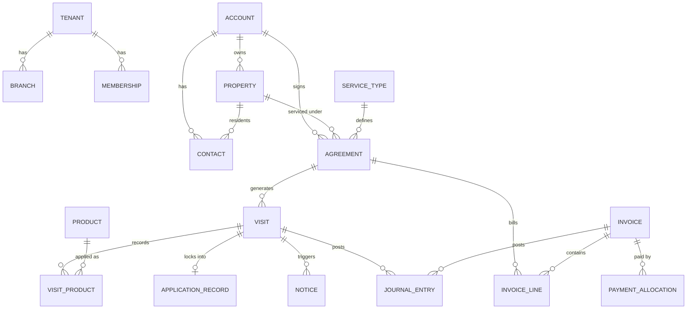

# Data model

The shared vocabulary every spec builds on. Specs may add columns; changing a relationship here needs a decision recorded in the spec.

## Conventions

- Primary keys: `id uuid default gen_random_uuid()`.
- Every tenant-owned table: `tenant_id uuid not null references tenants(id)`, RLS enabled, policies via `app.is_member(tenant_id)`.
- Branch-scoped tables also carry `branch_id`; branch scoping is enforced in the app layer through role scopes, tenant isolation in the database.
- Money: `*_cents bigint`. Quantities: `numeric`. Timestamps: `timestamptz`. Business dates: `date` in tenant time zone.
- `created_at`, `updated_at`, `created_by` on every table. Deletes are soft (`archived_at`) for anything referenced by financial or compliance records.
- Enum-like values are Postgres enums or check constraints, listed below in brackets.

## Overview

## Platform and tenancy

| Table | Key columns | Notes |
| --- | --- | --- |
| tenants | name, legal_name, timezone, stripe_account_id, status | One pest company; it may work in several states |
| branches | tenant_id, name, address, state_code, business_license_number, license_year | One business location; whether it needs its own license comes from its state's rule pack |
| memberships | tenant_id, user_id (auth.users), role, branch_ids uuid[] null, locale [en, es] | Null branch_ids means all branches; locale is the technician app's language, changed by the member through app.set_my_locale |
| roles | tenant_id null, key, permissions text[] | Platform defaults have tenant_id null; tenants copy and edit |
| invitations | tenant_id, email, role_id, branch_ids, token, expires_at, accepted_at | Accepting joins the signed-in user; an existing account gets a membership, never a duplicate user |
| platform_admins | user_id | Shared table; users of the platform console, who belong to no tenant |
| audit_log | tenant_id, actor_id, table_name, row_id, action, before, after | Written by triggers on sensitive tables |

## Customers and sales

| Table | Key columns | Notes |
| --- | --- | --- |
| accounts | tenant_id, name, type [residential, commercial, property_manager], billing_address, tax_exempt_cert_id, terms_days, status | Who pays |
| properties | tenant_id, account_id, address, state_code, lat, lng, property_type, size_sqft, unit_count, notes, registry_matches jsonb | Where work happens; its state selects the compliance rule pack |
| contacts | tenant_id, account_id null, property_id null, name, email, phone, role [billing, primary, resident, site_contact], sms_opt_in, e_notice_consent_at | Residents get pesticide notices |
| leads | tenant_id, contact fields, property address, source, stage [new, inspection_booked, quoted, won, lost], lost_reason, owner_id | Converts to account and property |
| quotes / quote_lines | tenant_id, lead_id or account_id, property_id, status, lines with price_book_item_id and price_cents | Tiered options as separate quote groups |

## Catalog and pricing

| Table | Key columns | Notes |
| --- | --- | --- |
| service_types | tenant_id, service_line [general_pest, rodent, termite, mosquito, bed_bug, wildlife], name, job_kind, treatment_areas text[] [interior, perimeter, yard, wood, devices], pricing_method [price_book, bid], default_duration_minutes, active | State packs map job kind and treatment areas to licensing, notice and blackout rules |
| service_type_state_rules | tenant_id, service_type_id, state_code, required_cert_categories text[], pack_cert_categories text[], tax_class [taxable, exempt, unknown], pack_tax_class, pack_version | Defaults come from the state pack and are copied onto the row; a check constraint keeps the pack's categories inside the tenant's (tighten, never loosen) |
| price_book_items | tenant_id, service_type_id, name, add_on bool, size_basis [none, size_sqft, lot_sqft], size_min, size_max (exclusive), initial_price_cents, recurring_price_cents, one_time_price_cents, position, active | An exclusion constraint keeps bands from overlapping within one item name |
| products | (shared) tenant_id null for master rows, name, manufacturer, epa_reg_no, active_ingredients text[], signal_word, restricted_use bool, rei_hours, formulation, label_url, sds_url, label_rates jsonb, upc (unique among master rows), verified_at | Platform-maintained master list; a tenant-added row carries its tenant_id until a platform admin approves it, which clears tenant_id and keeps the id |
| tenant_products | tenant_id, product_id, enabled, unit, unit_cost_cents | Tenant switches on and costs products; a trigger allows master rows and the tenant's own rows only |

## Agreements and visits

| Table | Key columns | Notes |
| --- | --- | --- |
| agreements | tenant_id, number, account_id, property_id, service_type_id, branch_id, quote_id, quote_option_id, status [draft, active, on_hold, cancelled, ended], cadence [monthly, bimonthly, quarterly, custom, seasonal_rounds], cadence_rule jsonb, season_start, season_end, skip_months, interior_only_months, initial_price_cents, recurring_price_cents, billing_mode [per_visit, flat_monthly, annual_prepay], term_months, renewals, auto_renew, cancel_fee_cents, starts_on, ends_on (trigger: start plus term times renewals), first_visit_on, window_days, terms_text, signed_at, signed_name, signed_by_contact_id, signed_ip, cancelled_on, cancel_reason_id, cancel_note, save_offer_made, save_outcome | Central object; renewal extends the same row |
| visits | tenant_id, agreement_id null, account_id, property_id, service_type_id, branch_id, kind [initial, recurring, reservice, one_time, inspection], sequence, due_start, due_end, scheduled_for, technician_id (the lead), route_position, arrival_window [any, morning, afternoon, evening], dispatch_notes, skip_reason, status [planned, scheduled, en_route, in_progress, completed, skipped, cancelled], price_cents, interior_only, reservice_reason, arrived_at, departed_at, completed_at, cancelled_at, started_by, conditions jsonb {temperature_f, wind_mph, wind_direction, sky, captured_at, source [weather, manual]}, areas_treated text[], target_pests text[], summary_sent_at | Re-services have price_cents 0 (check constraint); the status machine is a trigger; a scheduled visit needs a date and a lead; only dispatch and technicians move a visit past planned; in_progress stamps arrived_at and started_by, completed stamps departed_at (the legal application start and end) |
| visit_crew | tenant_id, visit_id, user_id, role [lead, applicator, supervisor, helper] | One lead per visit |
| cancel_reasons | tenant_id, key, name, active | Defaults seeded per tenant; in-use reasons deactivate, never delete |
| price_increases | tenant_id, kind [percent, amount], percent, amount_cents, effective_on, service_type_id, branch_id, billing_mode, rounding, applied_at, agreements_changed | A bulk run, applied once |
| agreement_price_changes | tenant_id, agreement_id, price_increase_id, old_recurring_price_cents, new_recurring_price_cents, effective_on, reason [bulk_increase, manual, renewal], notified_at | One row per agreement per change; spec 11 sends the notice |
| visit_products | tenant_id, visit_id, product_id, applied_by, site_treated, location_description, amount numeric, amount_unit, concentration_percent, carrier_amount, carrier_unit, area_treated, area_unit, mix_load_site, target_pests text[], label_check jsonb {status, reason}, client_id unique, recorded_at | Feeds the legal record; a trigger needs the product enabled for the tenant and applied_by on the crew, and a restricted-use product a certified, current, non-trainee applicator with the service type's categories |
| visit_notes | tenant_id, visit_id, kind [note, recommendation, condition_found, access], content, client_id unique, recorded_at | |
| visit_photos | tenant_id, visit_id, file_id, kind [before, after, posting, device, other], caption, taken_at, client_id unique | |
| visit_signatures | tenant_id, visit_id unique, file_id, signer_name, signed_at, client_id unique | One per visit |
| files | tenant_id, kind [photo, signature, document], content_type, byte_size (at most 5 MB), sha256, data bytea, client_id unique | Behind lib/files.ts; Supabase Storage replaces the inside later. Served only through /api/files/[id] under the viewer's session |
| sync_log | tenant_id, user_id, client_change_id unique, kind, visit_id, result [applied, rejected, duplicate], detail jsonb, applied_at | The technician app's idempotency ledger; readable by its author and dispatch.read |

## Compliance

| Table | Key columns | Notes |
| --- | --- | --- |
| applicator_credentials | tenant_id, user_id, state_code, cert_number, categories text[], cert_expires_on, license_number, license_expires_on, license_year, recert_credits jsonb, trainee_registered_on null, supervisor_id null | One row per technician per state; dispatch checks against it (spec 05), alerts and renewals come with spec 07 |
| application_records | tenant_id, visit_id (unique), state_code, pack_version, job_kind, business_date, arrived_at, departed_at, required_fields text[], missing_fields text[], complete, snapshot jsonb (the visit, captures, crew and credentials as of lock), status [draft, locked], lock_due_at, locked_at, locked_by, retention_until | One per completed pesticide visit; a trigger refuses any change once locked; the tenant foreign key restricts deletion |
| application_record_amendments | tenant_id, record_id, changed_fields jsonb {field: {from, to}}, reason, author_id | Append only, compliance.write, locked records only; the original stays in the snapshot |
| notices | tenant_id, kind [post_application, pre_application_offer, resident_notice, posting_sign, registry_advance, other], rule_key (the pack key, or default), required, dedupe_key (unique per tenant), visit_id null, agreement_id null, property_id, unit_id null, recipient_contact_id null, recipient_name, recipient_address, recipient_email, recipient_phone, channel [email, sms, print, mail, phone, posted], due_by, for_scheduled_for, status [due, sent, failed, waived], sent_at, proof jsonb, content_file_id, waived_reason | One obligation per row; a sent notice is immutable; email and SMS rows wait for spec 11 |
| notification_registries | tenant_id, state_code, registry_kind, registry_year, name, line1, line2, city, postal_code, normalized_address, contact_name, phone, email, notes, source_file_id, imported_at, row_hash (unique per tenant, state, kind, year) | Imported per state; properties.registry_matches is kept by trigger and app.rematch_registry_state |
| compliance_tasks | tenant_id, kind [credential_expiring, license_expiring, record_incomplete, notice_overdue, registry_notice_due], subject_table, subject_id, due_on, title, status [open, done, dismissed], done_at, done_by, note | Unique per (kind, subject, due date); raised by the compliance job, closed by people or by the fact that fixes them |
| compliance_exports | tenant_id, from_date, to_date, state_code, file_count | One row per inspector export, so the audit log shows who exported what |

## Billing

| Table | Key columns | Notes |
| --- | --- | --- |
| invoices | tenant_id, account_id, number, issued_on, due_on, status, po_number, subtotal_cents, tax_cents, total_cents | |
| invoice_lines | tenant_id, invoice_id, agreement_id null, visit_id null, description, amount_cents, tax_class, tax_jurisdiction_id, tax_cents | |
| payments | tenant_id, account_id, amount_cents, method, stripe_payment_intent_id, received_at, status | |
| payment_allocations | tenant_id, payment_id, invoice_id, amount_cents | |
| payment_methods | tenant_id, account_id, stripe_payment_method_id, brand, last4, autopay | No card data stored |
| tax_jurisdictions / tax_rates | (shared) code, name, type [state, county, city, district], rate, effective_from | Loaded from each state revenue department's rate tables |

## General ledger

| Table | Key columns | Notes |
| --- | --- | --- |
| gl_accounts | tenant_id, number, name, type [asset, liability, equity, revenue, expense], subtype | Seeded from the pest template |
| journal_entries | tenant_id, posted_on, source_type, source_id, memo, reversed_by | One per business event |
| journal_lines | tenant_id, entry_id, gl_account_id, debit_cents, credit_cents, agreement_id null, jurisdiction_id null | Agreement and jurisdiction subledgers |
| period_closes | tenant_id, period, closed_at, closed_by | Closed periods reject postings |

## Inventory

| Table | Key columns | Notes |
| --- | --- | --- |
| stock_locations | tenant_id, branch_id, kind [warehouse, truck], vehicle_id null | |
| stock_movements | tenant_id, product_id, from_location_id, to_location_id, quantity, unit, reason [receipt, transfer, usage, adjustment], visit_product_id null | Usage rows created from visit_products |

## Tables for specs 11 to 21 (named now so specs do not collide)

routes, route_stops, devices, device_checks, site_maps, sightings, recommendations, warranties, commissions, door_knocks, time_entries, message_threads, webhooks, api_keys. Each spec defines its own columns.
