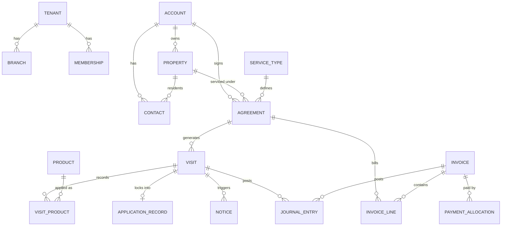

# Data model

The shared vocabulary every spec builds on. Specs may add columns; changing a relationship here needs a decision recorded in the spec.

## Conventions

- Primary keys: `id uuid default gen_random_uuid()`.
- Every tenant-owned table: `tenant_id uuid not null references tenants(id)`, RLS enabled, policies via `app.is_member(tenant_id)`.
- Branch-scoped tables also carry `branch_id`; branch scoping is enforced in the app layer through role scopes, tenant isolation in the database.
- Money: `*_cents bigint`. Quantities: `numeric`. Timestamps: `timestamptz`. Business dates: `date` in tenant time zone.
- `created_at`, `updated_at`, `created_by` on every table. Deletes are soft (`archived_at`) for anything referenced by financial or compliance records.
- Enum-like values are Postgres enums or check constraints, listed below in brackets.

## Overview

## Platform and tenancy

| Table | Key columns | Notes |
| --- | --- | --- |
| tenants | name, legal_name, timezone, stripe_account_id, status [active, suspended, archived], status_reason, status_changed_at, archived_at | One pest company; it may work in several states. Not active means read only for everyone signed in (the tenant_write_guard trigger on every tenant table); only platform staff change status |
| branches | tenant_id, name, address, state_code, business_license_number, license_year | One business location; whether it needs its own license comes from its state's rule pack |
| memberships | tenant_id, user_id (auth.users), role, branch_ids uuid[] null, locale [en, es] | Null branch_ids means all branches; locale is the technician app's language, changed by the member through app.set_my_locale |
| roles | tenant_id null, key, permissions text[] | Platform defaults have tenant_id null; tenants copy and edit |
| invitations | tenant_id, email, role_id, branch_ids, token, expires_at, accepted_at | Accepting joins the signed-in user; an existing account gets a membership, never a duplicate user |
| platform_admins | user_id | Shared table; users of the platform console, who belong to no tenant |
| audit_log | tenant_id, actor_id, table_name, row_id, action, before, after | Written by triggers on sensitive tables |

## Customers and sales

| Table | Key columns | Notes |
| --- | --- | --- |
| accounts | tenant_id, name, type [residential, commercial, property_manager], billing_address, tax_exempt_cert_id, terms_days, status, external_id (old-system id, unique per tenant) | Who pays |
| properties | tenant_id, account_id, address, state_code, lat, lng, property_type, size_sqft, unit_count, notes, registry_matches jsonb, external_id | Where work happens; its state selects the compliance rule pack |
| contacts | tenant_id, account_id null, property_id null, name, email, phone, role [billing, primary, resident, site_contact], sms_opt_in, e_notice_consent_at, external_id | Residents get pesticide notices |
| leads | tenant_id, contact fields, property address, source, stage [new, inspection_booked, quoted, won, lost], lost_reason, owner_id | Converts to account and property |
| quotes / quote_lines | tenant_id, lead_id or account_id, property_id, status, lines with price_book_item_id and price_cents | Tiered options as separate quote groups |

## Catalog and pricing

| Table | Key columns | Notes |
| --- | --- | --- |
| service_types | tenant_id, service_line [general_pest, rodent, termite, mosquito, bed_bug, wildlife], name, job_kind, treatment_areas text[] [interior, perimeter, yard, wood, devices], pricing_method [price_book, bid], default_duration_minutes, active | State packs map job kind and treatment areas to licensing, notice and blackout rules |
| service_type_state_rules | tenant_id, service_type_id, state_code, required_cert_categories text[], pack_cert_categories text[], tax_class [taxable, exempt, unknown], pack_tax_class, pack_version | Defaults come from the state pack and are copied onto the row; a check constraint keeps the pack's categories inside the tenant's (tighten, never loosen) |
| price_book_items | tenant_id, service_type_id, name, add_on bool, size_basis [none, size_sqft, lot_sqft], size_min, size_max (exclusive), initial_price_cents, recurring_price_cents, one_time_price_cents, position, active | An exclusion constraint keeps bands from overlapping within one item name |
| products | (shared) tenant_id null for master rows, name, manufacturer, epa_reg_no, active_ingredients text[], signal_word, restricted_use bool, rei_hours, formulation, label_url, sds_url, label_rates jsonb, upc (unique among master rows), verified_at | Platform-maintained master list; a tenant-added row carries its tenant_id until a platform admin approves it, which clears tenant_id and keeps the id |
| tenant_products | tenant_id, product_id, enabled, unit, unit_cost_cents | Tenant switches on and costs products; a trigger allows master rows and the tenant's own rows only |

## Agreements and visits

| Table | Key columns | Notes |
| --- | --- | --- |
| agreements | tenant_id, number, account_id, property_id, service_type_id, branch_id, quote_id, quote_option_id, status [draft, active, on_hold, cancelled, ended], cadence [monthly, bimonthly, quarterly, custom, seasonal_rounds, job_plan], cadence_rule jsonb (job_plan: steps [{label, offset_days, window_days}], 1 to 20), recognition [per_visit, straight_line], season_start, season_end, skip_months, interior_only_months, initial_price_cents, recurring_price_cents, billing_mode [per_visit, flat_monthly, annual_prepay], term_months, renewals, auto_renew, cancel_fee_cents, starts_on, ends_on (trigger: start plus term times renewals), first_visit_on, window_days, terms_text, signed_at, signed_name, signed_by_contact_id, signed_ip, cancelled_on, cancel_reason_id, cancel_note, save_offer_made, save_outcome, external_id, cutover_on, imported_billed_cents, import_batch_id | Central object; renewal extends the same row. An imported agreement bills from its cutover; the old system billed imported_billed_cents before it |
| visits | tenant_id, agreement_id null, account_id, property_id, service_type_id, branch_id, kind [initial, recurring, reservice, one_time, inspection], sequence, due_start, due_end, scheduled_for, technician_id (the lead), route_position, arrival_window [any, morning, afternoon, evening], dispatch_notes, skip_reason, status [planned, scheduled, en_route, in_progress, completed, skipped, cancelled], price_cents, interior_only, reservice_reason, step_label (the job plan step it came from), arrived_at, departed_at, completed_at, cancelled_at, started_by, conditions jsonb {temperature_f, wind_mph, wind_direction, sky, captured_at, source [weather, manual]}, areas_treated text[], target_pests text[], summary_sent_at, imported (done before Bugsy: completed with no times, no record, no invoice, no revenue, never moves) | Re-services have price_cents 0 (check constraint); the status machine is a trigger; a scheduled visit needs a date and a lead; only dispatch and technicians move a visit past planned; in_progress stamps arrived_at and started_by, completed stamps departed_at (the legal application start and end) |
| visit_crew | tenant_id, visit_id, user_id, role [lead, applicator, supervisor, helper] | One lead per visit |
| cancel_reasons | tenant_id, key, name, active | Defaults seeded per tenant; in-use reasons deactivate, never delete |
| price_increases | tenant_id, kind [percent, amount], percent, amount_cents, effective_on, service_type_id, branch_id, billing_mode, rounding, applied_at, agreements_changed | A bulk run, applied once |
| agreement_price_changes | tenant_id, agreement_id, price_increase_id, old_recurring_price_cents, new_recurring_price_cents, effective_on, reason [bulk_increase, manual, renewal], notified_at | One row per agreement per change; spec 11 sends the notice |
| visit_products | tenant_id, visit_id, product_id, applied_by, site_treated, location_description, amount numeric, amount_unit, concentration_percent, carrier_amount, carrier_unit, area_treated, area_unit, mix_load_site, target_pests text[], label_check jsonb {status, reason}, client_id unique, recorded_at | Feeds the legal record; a trigger needs the product enabled for the tenant and applied_by on the crew, and a restricted-use product a certified, current, non-trainee applicator with the service type's categories |
| visit_notes | tenant_id, visit_id, kind [note, recommendation, condition_found, access], content, client_id unique, recorded_at | |
| visit_photos | tenant_id, visit_id, file_id, kind [before, after, posting, device, other], caption, taken_at, client_id unique | |
| visit_signatures | tenant_id, visit_id unique, file_id, signer_name, signed_at, client_id unique | One per visit |
| files | tenant_id, kind [photo, signature, document, import], content_type, byte_size (at most 5 MB; 20 MB for import), sha256, data bytea, client_id unique | Behind lib/files.ts; Supabase Storage replaces the inside later. Served only through /api/files/[id] under the viewer's session |
| sync_log | tenant_id, user_id, client_change_id unique, kind, visit_id, result [applied, rejected, duplicate], detail jsonb, applied_at | The technician app's idempotency ledger; readable by its author and dispatch.read |

## Compliance

| Table | Key columns | Notes |
| --- | --- | --- |
| applicator_credentials | tenant_id, user_id, state_code, cert_number, categories text[], cert_expires_on, license_number, license_expires_on, license_year, recert_credits jsonb, trainee_registered_on null, supervisor_id null | One row per technician per state; dispatch checks against it (spec 05), alerts and renewals come with spec 07 |
| application_records | tenant_id, visit_id (unique), state_code, pack_version, job_kind, business_date, arrived_at, departed_at, required_fields text[], missing_fields text[], complete, snapshot jsonb (the visit, captures, crew and credentials as of lock), status [draft, locked], lock_due_at, locked_at, locked_by, retention_until | One per completed pesticide visit; a trigger refuses any change once locked; the tenant foreign key restricts deletion |
| application_record_amendments | tenant_id, record_id, changed_fields jsonb {field: {from, to}}, reason, author_id | Append only, compliance.write, locked records only; the original stays in the snapshot |
| notices | tenant_id, kind [post_application, pre_application_offer, resident_notice, posting_sign, registry_advance, other], rule_key (the pack key, or default), required, dedupe_key (unique per tenant), visit_id null, agreement_id null, property_id, unit_id null, recipient_contact_id null, recipient_name, recipient_address, recipient_email, recipient_phone, channel [email, sms, print, mail, phone, posted], due_by, for_scheduled_for, status [due, sent, failed, waived], sent_at, proof jsonb, content_file_id, waived_reason | One obligation per row; a sent notice is immutable; email and SMS rows wait for spec 11 |
| notification_registries | tenant_id, state_code, registry_kind, registry_year, name, line1, line2, city, postal_code, normalized_address, contact_name, phone, email, notes, source_file_id, imported_at, row_hash (unique per tenant, state, kind, year) | Imported per state; properties.registry_matches is kept by trigger and app.rematch_registry_state |
| compliance_tasks | tenant_id, kind [credential_expiring, license_expiring, record_incomplete, notice_overdue, registry_notice_due, notice_undelivered], subject_table, subject_id, due_on, title, status [open, done, dismissed], done_at, done_by, note | Unique per (kind, subject, due date); raised by the compliance job (notice_undelivered by messaging when a sent notice bounces), closed by people or by the fact that fixes them |
| compliance_exports | tenant_id, from_date, to_date, state_code, file_count | One row per inspector export, so the audit log shows who exported what |

## Billing

| Table | Key columns | Notes |
| --- | --- | --- |
| invoices | tenant_id, number (per tenant from counters, assigned at issue), kind [invoice, credit_memo], account_id, property_id null, agreement_id null, visit_id null, status [draft, issued, partially_paid, paid, past_due, void], issued_on, due_on, terms_days, po_number, subtotal_cents, tax_cents, total_cents, paid_cents, memo, source [visit, installment, prepay, settlement, late_fee, manual, opening, materials], source_key (unique per tenant), external_ref (old invoice number), tax_unconfirmed, void_reason, voided_at, voided_by | Immutable once issued (trigger); void only with a reason and no payments; tenant deletion restricted |
| invoice_lines | tenant_id, invoice_id, position, agreement_id null, visit_id null, service_type_id null, service_line, description, amount_cents, tax_class [taxable, exempt, unknown, exempt_certificate], tax_rate numeric, tax_breakdown jsonb [{kind, name, rate, cents}], tax_cents | Lines change only on a draft |
| payments | tenant_id, account_id, kind [payment, refund], method [card, us_bank_account, cash, check, other], status [pending, succeeded, failed, refunded], amount_cents, gateway, gateway_payment_id, payment_method_id, refund_of, reference, failure_reason, received_at, visit_id null, recorded_by, memo | A refund is its own row pointing at the payment; the crew records cash and checks for their own visit |
| payment_allocations | tenant_id, payment_id, invoice_id, amount_cents | Never more than the payment or the invoice (trigger); paid_cents and paid or partially paid status follow |
| payment_methods | tenant_id, account_id, gateway, gateway_payment_method_id, kind [card, us_bank_account], brand, last4, exp_month, exp_year, autopay, is_default, status [active, removed], added_by | No card or bank numbers; one default per account |
| tax_rates | (shared) state_code, postal_code, jurisdiction_kind [state, county, city, district], jurisdiction_name, rate numeric, effective_from, effective_to, source | From each state revenue department, written by platform admins; empty until a launch state is loaded |
| billing_settings | tenant_id (unique), late_fee_cents, late_fee_percent, grace_days, pause_when_past_due, autopay_retry_days int[], invoice_footer, gateway [local, stripe], gateway_account_id, gateway_onboarded_at | One row per company |
| autopay_attempts | tenant_id, invoice_id, payment_method_id, attempt, scheduled_for, attempted_at, result [succeeded, failed, skipped], payment_id, error | Unique per invoice and attempt |
| gateway_events | (shared) gateway, event_id (unique), type, received_at, payload, tenant_id null | The webhook idempotency ledger |

## General ledger

| Table | Key columns | Notes |
| --- | --- | --- |
| gl_accounts | tenant_id, key (template key, null for custom), number, name, type [asset, liability, equity, revenue, expense], subtype, active, system | Created from the pest template (lib/ledger/chart.ts) by the first posting; template accounts keep key, type and subtype and are never deleted |
| journal_entries | tenant_id, number (per tenant), posted_on, period (YYYY-MM, kept by trigger), source_type [invoice, credit_memo, void, visit, product_use, payment, refund, payout, reclass, reclass_reversal, opening, manual, reversal, recognition], source_id, source_key (unique per tenant), memo, reverses, reversed_by, posted_by | One per business event; written only through app.post_entry, which checks the balance and the period; never edited or deleted, only reversed |
| journal_lines | tenant_id, entry_id, position, gl_account_id, debit_cents, credit_cents (one side positive), agreement_id null, jurisdiction null (kind:name), memo | The contract subledger (agreement_id on contract liability lines) and the sales tax subledger; a text jurisdiction key rather than a rate row id because rate rows change with effective dates |
| period_closes | tenant_id, period, status [closed, reopened], closed_at, closed_by, reopened_at, reopened_by, reopen_reason | Closed periods reject postings; reopening needs an owner and a reason; audited |
| payouts | tenant_id, gateway, gateway_payout_id (unique per gateway), arrived_on, gross_cents, fee_cents, net_cents, status, payload | What the gateway sent to the bank; payments.payout_id points at it; immutable |

## Messaging

| Table | Key columns | Notes |
| --- | --- | --- |
| messaging_settings | tenant_id (unique), sender_name, reply_to_email, company_phone, sms_number, sms_registration, quiet_start, quiet_end, reminders_enabled, reminder_days, on_the_way_enabled, summary_enabled, review_enabled, review_url, review_delay_hours, review_every_days, invoice_email_enabled, email_provider, sms_provider, mail_provider | Created on first use by app.ensure_messaging_settings |
| message_templates | tenant_id, key, channel, subject, body | Company overrides of the built-in templates in lib/messaging/templates.ts |
| messages | tenant_id, direction [outbound, inbound], channel [email, sms, mail], purpose, account_id, property_id, contact_id, visit_id, notice_id, invoice_id, campaign_id, to_address, from_address, subject, body, body_html, status [queued, sent, delivered, failed, suppressed, received], suppressed_reason, provider, provider_message_id, segments, dedupe_key, token, send_after, claimed_at, sent_at, delivered_at, failed_at, read_at | The outbox, the account timeline and notice proof. Written through app.queue_message and app.record_message_status; a sent message keeps what it said; status moves forward only |
| message_opt_outs | tenant_id, channel [sms, email], address, reason [stop, unsubscribe, bounce, complaint, manual], message_id | Checked at send time |
| campaigns | tenant_id, name, channel, subject, body, audience jsonb, status, scheduled_for, counts, sent_at | One message per selected account |

## Import

| Table | Key columns | Notes |
| --- | --- | --- |
| import_batches | tenant_id, status [dry_run, committed, failed], cutover_on, summary jsonb (per file: rows, created, skipped, errors), errors jsonb, warnings jsonb, created_by | One per dry run or import; never changes. A commit writes everything or nothing |
| import_files | tenant_id, batch_id, file_id, kind [template, history], file_name, label | The uploaded spreadsheets and the old system's records, kept for the retention period; history is readable by compliance.read |

## Commercial programs

| Table | Key columns | Notes |
| --- | --- | --- |
| site_maps | tenant_id, property_id, name, file_id (PNG, JPEG or WebP), width, height, position, archived_at | A floor plan; devices sit on it by fractions of its width and height |
| devices | tenant_id, property_id, number (unique per property among active), barcode (unique per company), kind [bait_station, rodent_trap, multi_catch, glue_board, insect_light_trap, pheromone_trap, termite_station], zone [interior, exterior, perimeter], location, map_id, x, y, product_id, installed_on, removed_on, removed_reason, status [active, removed], client_id | Removed, never deleted. Written by the office, or by a technician on the crew of an open visit at the property |
| device_events | tenant_id, device_id, kind [installed, moved, removed, relabeled], before, after, visit_id, at, by | Written by a trigger on devices, so every path records history; the visit comes from the transaction setting app.visit_id |
| device_checks | tenant_id, device_id, visit_id, checked_at, checked_by, source [technician, office, sensor], status [checked, inaccessible, missing, damaged], activity [none, low, medium, high], count, bait_consumed_pct, pest, actions, notes, client_id | One per device per visit; read only once the visit is completed. Office paper entries and sensors have no visit |
| sightings | tenant_id, property_id, seen_at, location, pest, count, reported_by, source [customer, office, technician], notes, visit_id, resolved_at, resolution | Open until resolved with a note |
| recommendations | tenant_id, property_id, visit_id, sighting_id, category, description, responsibility [customer, company], priority, owner_name, due_on, status [open, in_progress, closed], closed_on, closed_note, client_id | Corrective actions tracked to a closed date |
| site_documents | tenant_id, property_id, file_id, title, kind, valid_until, shared | The program, insurance, licenses, labels and SDS for the customer's auditor; the portal (spec 16) shows the shared ones |

service_types.device_kinds names the device kinds a visit of that type checks; the completion gate requires a check for each active one.

## Specialty services

| Table | Key columns | Notes |
| --- | --- | --- |
| job_authorizations | tenant_id, agreement_id, signer_name, relationship [owner, owner_agent, tenant_with_consent, property_manager], signed_on, scope, file_id, recorded_by | The landowner's written authorization for a wildlife job; dispatch refuses trapping, exclusion, bat exclusion and repair visits until one is on file |
| wildlife_captures | tenant_id, visit_id, species, count (1 to 1000), disposition [relocated, released_on_site, euthanized, transferred, escaped, dead_on_arrival], location, notes, client_id | Written by the crew of an open visit; closed with the visit |
| visit_materials | tenant_id, visit_id, description, quantity numeric(12,3), unit, unit_price_cents, billable, client_id | Billable ones become one invoice at completion (source materials, key materials:<visit>), lines at quantity times price half up to the cent; the rest are job costing only. Closed with the visit |
| prep_checks | tenant_id, visit_id unique, ready, missing text[], notes, checked_by, checked_at, client_id | The technician's check of the customer's prep at the door; not ready needs what was missing or a note. Closed with the visit |
| diagram_marks | tenant_id, property_id, map_id (one of the property's own maps), kind [damage, evidence, treated, inaccessible, moisture, note], x, y (0 to 1), label | The termite graph on a site map (spec 14), written by customers.write or dispatch.write |
| wdi_reports | tenant_id, visit_id unique (an inspection or WDI visit), number, requested_by, buyer, seller, structures, inspected_areas, inaccessible_areas, findings jsonb {live_insects, dead_insects, damage, evidence, previous_treatment: {seen, where}}, treatment_recommended, notes, inspector_id, status [draft, issued], issued_at, issued_by | A draft by compliance.write or the inspecting crew; issued only by compliance.write, which takes the next number; an issued report never changes or goes away |

service_types.job_plan holds the plan new job agreements start from and service_types.prep_checklist the list the reminder carries and the technician confirms. A straight-line agreement (warranties) earns each billed amount evenly by day over the term it pays for: the ledger job posts each ended month once (journal source type recognition, key straight_line:<agreement>:<month>) and its visits earn nothing on completion.

## Customer portal and booking

| Table | Key columns | Notes |
| --- | --- | --- |
| portal_users | tenant_id, account_id, contact_id, email, user_id (set on acceptance), property_ids uuid[] (null: all of the account's), status [invited, active, disabled], token, invited_by, invited_at, accepted_at | A customer's access to one account. Staff read every column but token (the link goes only into the customer's message, and the audit trail drops it); a trigger keeps the office from activating, re-pointing or re-addressing an identity, and acceptance needs the invited address confirmed by the auth provider. The server names the identity in the session claims (portal_user) and app.portal_user_id() honors it only for the signed-in user's own active row, so the Data API never grants portal access. Additive select policies (app.portal_account, app.portal_property) let the identity read its account's rows under each table's own row level security |
| portal_settings | tenant_id unique, allow_reschedule, reschedule_notice_hours, max_stops_per_day, allow_requests, requestable_service_type_ids | The office's rules for self-service |
| service_requests | tenant_id, account_id, property_id, portal_user_id, kind [reservice, booking, reschedule], visit_id, agreement_id, service_type_id, preferred_date, arrival_window, details, status [open, done, declined], response, result_visit_id, handled_by, handled_at | What customers ask for; the office books it, marks it done or declines with a note. A customer's own move is recorded as a done reschedule |
| lead_forms | tenant_id, key (public), name, service_type_ids, ask_preferred_date, thank_you, active | A booking form for the company's website: hosted at /f/<key>, or JSON to /api/intake/<key> |
| intake_log | tenant_id, form_id, ip_hash, result [accepted, limited, refused], lead_id | Rate limits (5 an hour per address hash across every form, 200 a day per form, taken under a lock so parallel posts count) and a record of submissions, refusals included; the address itself is never stored. Accepted leads carry the source website_form |

leads gain service_type_id, preferred_date, arrival_window, form_id and sms_consent for submissions from a booking form. invoices.source gains materials (spec 15). Portal payments post to the ledger on the next sweep.

## Sales and growth

| Table | Key columns | Notes |
| --- | --- | --- |
| territories | tenant_id, name, zip_codes text[], streets text[], rep_ids uuid[], active | A manager (customers.write and users.read) sees and edits every territory; a rep only the ones naming them |
| knocks | tenant_id, territory_id, rep_id, address, normalized_address, postal_code, lat, lng, outcome [not_home, not_interested, come_back, sold, do_not_knock], notes, follow_up_at, lead_id, agreement_id, knocked_at, cleared_at | What happened at each door; a do-not-knock stays until the office clears it. A rep knocks only in an assigned territory and reads only their territories' knocks. lat/lng come from the phone at the door when allowed |
| commission_plans | tenant_id, name, role_keys, user_ids, basis [initial, first_year, flat], percent numeric, flat_cents, hold_days, hold_paid_invoices, chargeback_days, active | Who a plan covers (by role or by name) and how much |
| commissions | tenant_id, user_id, agreement_id, plan_id, basis_cents, amount_cents, status [held, payable, paid, charged_back], earned_on, releasable_on, released_on, paid_on, payout_id, charged_back_on, recovered_payout_id, hold_paid_invoices, chargeback_days | One per seller, agreement and plan. app.commissions_guard works the amount out again from the plan and the agreement, snapshots the plan's hold terms, accepts a member's insert only in the signing itself, and allows only release (billing staff, hold met), payout and in-window chargeback. Payable ones post commissions expense to commissions payable |
| commission_payouts | tenant_id, user_id, paid_on, amount_cents, method, reference, paid_by | One payment of a seller's payable commissions, net of paid ones since charged back; posts commissions payable to the bank |
| sequences | tenant_id, name, trigger [quote_open, renewal_due, seasonal_upsell, win_back], settings jsonb, steps jsonb [{delay_days, channel, subject, body}], active | Timed messages under spec 11's consent and quiet hours |
| sequence_enrollments | tenant_id, sequence_id, subject_key (unique per sequence), account_id, lead_id, quote_id, agreement_id, step, next_at, status [active, completed, stopped], stopped_reason | Each subject once; stops when the subject acts or opts out |
| growth_settings | tenant_id unique, referral_credit_cents, survey_enabled | A portal customer reads it for their referral card |
| surveys | tenant_id, visit_id unique, account_id, token, score 0 to 10, comment, sent_at, responded_at | Sent with the visit summary; answered once through app.answer_survey with no login |
| referral_credits | tenant_id, referrer_account_id, referred_account_id, agreement_id unique, amount_cents, credit_memo_id | The referrer's credit memo when a referred customer signs their first plan; written by billing staff or the billing job |

agreements gain sold_by (one of the company's people, fixed once signed), knock_id and signature_file_id (the drawn signature at the door); accounts gain referral_code (unique across every company); leads gain referred_by_account_id; invoices.source gains referral; journal_entries.source_type gains commission and commission_payout. The permission payments.capture saves a card on an account and nothing more (sales reps and office staff).

## Platform operations

| Table | Key columns | Notes |
| --- | --- | --- |
| support_grants | tenant_id, user_id, user_email, access [read, write], reason, hours (1 to 72), requested_at, approved, decided_at, decided_by, expires_at, revoked_at, revoked_by | Platform support's access to one company, asked for by a platform admin and approved by an owner; live from approval for its hours. Written through app.request_support, app.decide_support and app.revoke_support. While live, app.is_member and app.has_permission answer for its holder |
| support_access_log | tenant_id, grant_id, user_id, path, method, created_at | One row per page, download or action under a live grant, read by the company's audit.read members |
| tenant_purges | former_tenant_id, name, archived_at, purged_at, purged_by, row_counts | Shared: the platform's record that an archived company's data was deleted (app.purge_tenant, only past 90 days archived and past every record's retention) |

## Reporting

| Table | Key columns | Notes |
| --- | --- | --- |
| saved_reports | tenant_id, name, dataset, definition jsonb (columns, filters, group_by, aggregates, sort, limit), shared, created_by, updated_at | A custom report over one of the datasets in lib/reports/datasets.ts. Private to its author unless shared; written by the author; an owner may delete a shared one. Runs under the reader's session, so row level security decides the rows. Every metric is computed on demand; there are no snapshot tables |

## Inventory, time and payroll

| Table | Key columns | Notes |
| --- | --- | --- |
| inventory_settings | tenant_id unique, tracking_since | Usage comes off the shelves for visits completed from this day; set when the first location is made |
| stock_locations | tenant_id, branch_id, kind [warehouse, truck], name, user_id (the truck's technician), active | One active warehouse per branch and one active truck per person. A technician reads only their own truck |
| stock_movements | tenant_id, product_id, kind [receipt, transfer, usage, adjustment], from_location_id, to_location_id, quantity (in the tenant product's unit), unit, unit_cost_cents, value_cents, visit_id, visit_product_id unique, vendor, reference, paid [now, on_account], note, occurred_at | Never changed or deleted. Receipts and counts run through app.stock_receive and app.stock_count, which take the product's lock and keep its moving average cost on tenant_products.unit_cost_cents; usage comes off the lead technician's truck (or the visit's branch warehouse) through app.record_usage, which works the quantity out from the record |
| time_entries | tenant_id, user_id, started_at, ended_at, source [app, office], note, edited_by, edited_at, edit_reason, pay_period_id | No overlap and one open entry per person; a person clocks only themselves; payroll corrects with a reason; an exported period's entries are fixed |
| pay_settings | tenant_id unique, period [weekly, biweekly, semimonthly], anchor_on | The workweek starts on the anchor's weekday |
| pay_rates | tenant_id, user_id, kind [hourly, production, salary], hourly_rate_cents, production_percent, draw_cents, salary_cents, labor_cost_cents_per_hour, effective_from | Payroll reads every rate, a person their own; job costing reads only the labor cost through app.labor_costs |
| pay_periods | tenant_id, starts_on, ends_on (periods never overlap), status [exported, posted], exported_at, exported_by, gross_wages_cents, employer_taxes_cents, withholdings_cents, net_pay_cents, commissions_cents, posted_on | Exported once; the payroll journal posts once from the register's totals |
| pay_period_lines | tenant_id, pay_period_id, user_id, payroll_id, name, email, kind, hours, hours_by_week, hourly_rate_cents, production_revenue_cents, production_percent, production_pay_cents, draw_cents, salary_cents, pay_due_cents, commissions_cents | The export as sent to the payroll provider |

tenant_products gain truck_minimum and warehouse_minimum; memberships gain payroll_id (set through app.set_payroll_id); commission_payouts gain pay_period_id (commissions paid through payroll, posted by the payroll journal). The chart gains accounts_payable; journal_entries.source_type gains stock_receipt, stock_adjustment and payroll.

## Routing and fleet

| Table | Key columns | Notes |
| --- | --- | --- |
| route_settings | tenant_id unique, average_speed_mph, day_starts_at, morning_ends_at, afternoon_ends_at, fill_in_miles, position_days | Distances are great-circle miles; drive time is miles over the speed |
| technician_positions | tenant_id, user_id, lat, lng, accuracy_m, recorded_at | From the phone while the person is clocked in or on the way to a stop; read by dispatch (dispatch.write) and the person; purged after position_days by the messaging job |
| route_runs | tenant_id, kind [optimize, assign, fill_in], technician_id, branch_id, date, before, after, miles_before, miles_after, applied_at | What a suggestion proposed (recorded at preview, with the day's fingerprint) and when it was applied; an assignment run keeps the placements taken |

branches gain lat and lng, the route's start and end. The on-the-way template gains {{eta}}.

## Integrations and API

| Table | Key columns | Notes |
| --- | --- | --- |
| api_keys | tenant_id, name, prefix unique, key_hash, scopes, last_used_at, revoked_at, created_by | The secret is shown once; members never read key_hash (column privileges). The API runs as anon through `app.api_*` definer functions that check the key's scope |
| api_requests | tenant_id, api_key_id, method, path, status, at | Every call, without its body, for 30 days; the rate limit (60 a minute per key) counts these |
| webhook_subscriptions | tenant_id, url, events, secret, active, created_by | secret is hidden from members; a 410 answer turns a subscription off |
| webhook_deliveries | tenant_id, subscription_id, event, payload, attempt, status [pending, delivered, failed], response_status, response_body, next_at, delivered_at | Queued by triggers on leads, service_requests, visits and invoices; sent by the messaging job; kept 30 days |
| integration_connections | tenant_id, provider [quickbooks, phone] unique per tenant, status [connected, needs_reconnect, disconnected], settings, tokens, inbound_key, inbound_secret | tokens are sealed by the app (AES-256-GCM) and with inbound_secret never readable by members; QuickBooks is connected by gl.write, the phone by integrations.manage |
| quickbooks_account_map | tenant_id, gl_account_id unique, qbo_account_id, qbo_account_name | Bugsy account to QuickBooks account |
| quickbooks_syncs | tenant_id, day unique, status [sent, failed], qbo_entry_id, lines, error, attempts, sent_at | One summarized entry per day, sent once by the billing job |
| calls | tenant_id, direction, from_number, to_number, account_id, contact_id, lead_id, user_id, started_at, duration_seconds, recording_url, provider_call_id unique, notes | From the phone system's signed events (matched by number) and from click to call; read with customers.read |

leads, service_requests and device_checks gain api_key_id: what an API key wrote names the key, and only the API's own functions set it.
