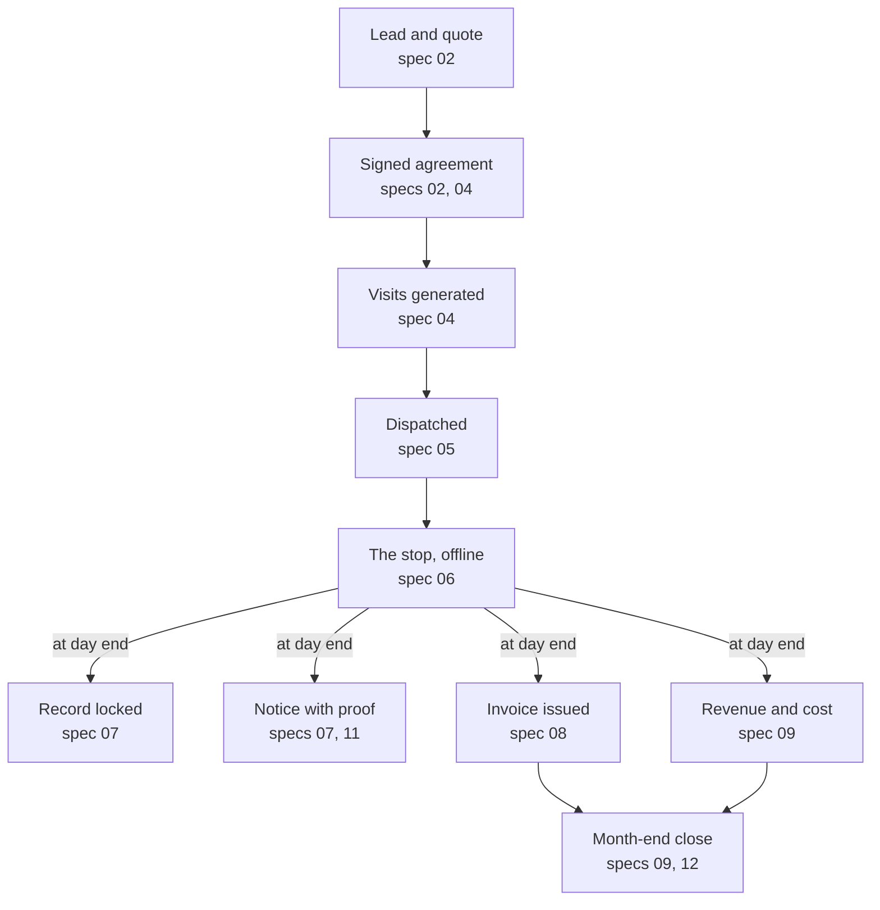
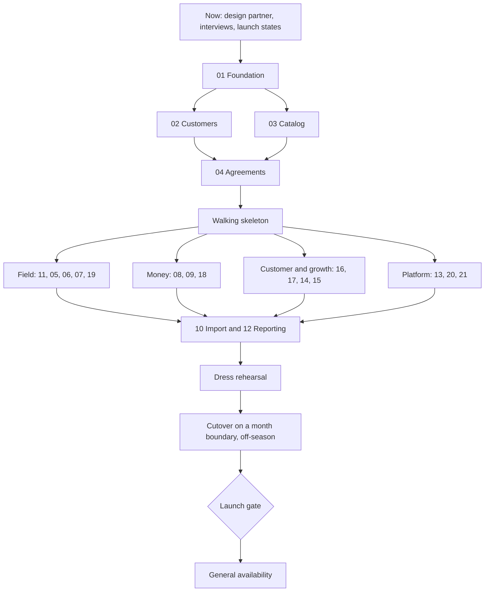

> **Source of truth.** This file is the Bugsy PRD. The interactive PRD site is built from it and from the feature data in `docs/competitors/` (`feature-taxonomy.json`, `bugsy-plan.json` and one profile per competitor), so the PRD and the feature crosswalk share one feature list. Edit here, then run `python3 -I docs/prd-site/build.py` to rebuild the site. HTML comments such as `page:` and `widget:` mark where site pages start and where interactive views go; GitHub hides them.

# Bugsy PRD

Version 3 · October 31, 2026 · Phil Klejwa

<!-- page: overview | Overview -->

## Summary

Bugsy is one platform for independent pest control companies: CRM, agreements, dispatch, an offline technician app, pesticide compliance, billing and a real general ledger. Everything on the feature list ships in one build; there are no phases. Version 3 drops the phasing and the Wisconsin focus of version 2, sizes the market nationally, and proposes features the list does not yet cover.

<!-- widget: kpis -->

- **The wedge holds.** None of the 9 competitors scored automates regulatory pesticide notices, enforces restricted-use rules, keeps a double-entry ledger, or tracks deferred revenue per agreement. State compliance elsewhere stops at report exports for a handful of states (California, New York, Arizona). No 2025 to 2026 competitor roadmap targets these gaps.
- **Table stakes are universal.** A map dispatch board, mobile app, field payments, autopay and standard reports are offered by all 9, some only on higher tiers. Reminder and on-the-way texts are offered by 7 of 9, and at least 6 of those charge extra for texting.
- **One build.** 78 of the 80 features on the list are in scope, built across 21 specs and shipped together. Only other accounting integrations and marketing services are out.
- **First customer:** an independent, residential-first pest company with one branch and 3 to 15 technicians, in any state. About 4,100 US firms fit.
- **Market:** 13,603 US pest control firms with $19.6B in receipts (2022). At $79 to $99 per technician, the target band is worth about $23M to $29M a year at full share, and all independents about $51M to $65M.
- **Closest rivals for small independents:** GorillaDesk and Fieldwork on price and ease, FieldRoutes for regional companies.
- **Pricing:** everything included. A base price plus a per-technician price, counted at a trailing peak, is proposed for testing.
- **Compliance is a rules engine.** Each state's rules are data; the launch states follow the design partner.
- **Decisions:** 12 calls, each with a recommendation.

"Bugsy" is a working name taken from the repository.

<!-- page: market | Market -->

## Problem and why now

Pest control companies run a recurring, regulated business on software built for generic field service, or on pest software that treats compliance as a report and the books as someone else's job. The cost lands on four people.

| Who | Today | What it costs them |
| --- | --- | --- |
| Owner | Software shows invoices, not contract positions; the books live in QuickBooks with an outside accountant | Revenue looks smooth while costs land in service months; a cancellation right after a visit leaks delivered but unbilled service; retention, route density and re-service cost stay invisible |
| Licensed manager | State application records, customer notices, notification registries and license dates kept on paper, spreadsheets or generic chemical logs | Hours of record keeping and no proof that every notice went out; a missed notice or unlicensed assignment puts the business license at risk |
| Technician | Retyping visit details. Housecall Pro is view-only offline; GorillaDesk caches only the current week and cannot edit job details offline. PestPac and Fieldwork claim full offline completion, but reviewers report sync failures | Lost time in basements and rural areas; incomplete or lost legal records |
| Office | Billing modes, winter skips, price increases and cancellations handled by hand | Errors at the most sensitive customer moments: the bill and the cancellation |

**Why now**

- **State compliance is still a report export.** PestPac and Fieldwork produce California and New York formats, PestPac and Pocomos touch Arizona, and Briostack claims WDI/WDO forms for all 50 states. Nobody applies state notice, registry or posting rules in the workflow.
- **Competitors are investing elsewhere.** Every competitor's 2025 to 2026 releases went to AI, analytics, payments and sales. None added compliance or accounting depth.
- **Buyers resent add-on fees and tier gating.** 5 of 9 now publish prices, so opacity matters less than what is left out of the base plan. Bugs after updates remain a common complaint. PestPac feeds QuickBooks through a periodic export, not a live sync.
- **Horizontal tools are cheap at entry, not for pest work.** Reminders and autopay need Jobber Connect, recurring service plans need Housecall Pro MAX, Jobber's chemical log is web-only, and Housecall Pro offers a printable paper log.
- **Residential growth is tightening.** Rollins reported 3.6% residential organic growth in Q2 2026 with falling lead volume, which raises the value of retention, re-service and contract-position reporting.
- **Switching moments exist.** FieldRoutes is moving ServSuite users in incentive cohorts with no public deadline, and Briostack's one-year auto-renewing contracts and fee schedule draw complaints.

## The market

The US has 13,603 employer pest control firms with $19.6B in receipts (2022). Census code 561710 excludes lawn care, so these figures are pest control only.

| Measure | Value | Year | Source |
| --- | --- | --- | --- |
| Employer firms | 13,603 (16,080 establishments) | 2022 | [Census SUSB](https://www2.census.gov/programs-surveys/susb/tables/2022/us_state_naics_detailedsizes_2022.txt) |
| Employer receipts | $19.56B | 2022 | Census SUSB |
| Employees | 139,917 | 2022 | Census SUSB |
| Pest control workers (technicians) | 89,070, about 60% of industry employment | 2023 | [BLS OEWS](https://www.bls.gov/oes/2023/may/naics5_561710.htm) |
| Firms with fewer than 5 employees | 8,882 | 2022 | Census SUSB |
| Firms with 5 to 9 employees | 2,491, about $737K receipts each | 2022 | Census SUSB |
| Firms with 10 to 14 employees | 906, about $1.35M each | 2022 | Census SUSB |
| Firms with 15 to 19 employees | 467, about $2.05M each | 2022 | Census SUSB |
| Firms with 20 to 24 employees | 224, about $2.63M each | 2022 | Census SUSB |
| Firms with 500 or more employees | 21, holding 42.6% of receipts and 36% of employment | 2022 | Census SUSB |

- **Target pool.** Firms with 5 to 24 employees (roughly 3 to 15 technicians at a 60% technician share) number about 4,090, with $4.6B in receipts and about 24,400 technicians.
- **Consolidation.** Private-equity platforms and national brands keep buying independents (in 2025, for example, Greenix, Plunkett's and Ecolab bought Midwest companies). Acquired firms move to the buyer's software, so the independent pool shrinks.
- **Seasonality.** Northern states swing hard: Wisconsin pest employment peaks at 1.33 to 1.44 times its winter low, against about 1.1 nationally. Pricing and staffing models must survive winter.

**Revenue ceiling.** At $79 to $99 per technician, the target band is worth about $23M to $29M a year at full share, all independents about $51M to $65M, and every US technician about $84M to $106M. Try other prices and shares below.

<!-- widget: market -->

The market is national independents. Launch geography matters for compliance rule packs and the design partner, not for market size.

<!-- page: customers | Customers -->

## Who we build for first

Recommendation: independent, residential-first pest companies with one branch and 3 to 15 technicians, in any state.

- Dispatch, routing and reporting at this size are well understood, and the full build covers them.
- The owner is usually also the licensed manager, so the buyer feels the compliance pain directly and decides quickly.
- There is no dedicated compliance or accounting staff, so automation replaces work nobody has time for.
- Multi-branch regionals and national brands bring custom integrations, procurement and migrations that slow a first launch. The data model stays multi-branch, so they can follow.

**What they run today.** Small independents run on GorillaDesk, Fieldwork, Pocomos, FieldRoutes, Briostack, horizontal tools such as Jobber and Housecall Pro, or spreadsheets and paper. In a 38-company website sample, most showed no visible software. GorillaDesk showcases pest firms with 13 to 27 technicians, so it is not only an owner-operator tool.

**Not first:** owner-operators with 1 or 2 technicians (price-led buyers; Fieldwork starts at $39 plus $19 per technician and GorillaDesk at $49), multi-branch regionals, national brands and lawn-care-first companies (out of scope).

| Persona | Role keys | Job to be done | Bugsy must deliver |
| --- | --- | --- | --- |
| Owner and licensed manager | owner, compliance_manager | Know the business is healthy and legal | Owner dashboard, AR, renewals, credential alerts, inspector export |
| Office manager, often also the dispatcher | office, dispatcher | Sign customers, fill routes, bill, answer the phone | Customer and agreement screens, dispatch board, billing, messaging |
| Technician | technician | Finish each stop fast and never enter anything twice | Offline app, product picker, notices handled in the flow, payments |
| Sales rep | sales_rep | Close new plans at the door or by phone | Door-to-door app, quotes, e-sign and card capture, commissions |
| Outside bookkeeper | bookkeeper | Close the month | Journal, deferred revenue roll-forward, QuickBooks sync |
| Residential customer | portal | Know when the technician comes and pay easily | Reminders, on-the-way text, portal, service summaries |
| Commercial customer | portal | Pass a food-safety audit | Device maps, trends, sighting log, audit binder |

**Where to find them.** State pest control association conferences and recertification events, NPMA's PestWorld, and the switching moments above. The design partner's state sets the first compliance rule pack. Wisconsin research (market, incumbents, channels, rules) is ready in `research_notes/` if the pilot lands there.

<!-- page: competitors | Competitors -->

## Competitors

Nine products are scored on the feature list. Select one below to see its profile and every score with its source.

| Product | Owner | Focus | Price model | Threat to small independents |
| --- | --- | --- | --- | --- |
| GorillaDesk | Private | 29 trades, customers skew pest | Per route, published, $49 to $149 a route | High: cheap, well liked, route optimization on every plan |
| Fieldwork | Fieldwork Software (linked to Anstar Products), Illinois | Pest first; also markets lawn and pool | Base plus per technician, published, office users free | High: same price model as Bugsy, lower price |
| FieldRoutes | ServiceTitan | Pest and lawn | Per active customer, quote only | High for regional companies: deep product, 1,700+ companies |
| Pocomos | Private | Residential pest, door-to-door | Per active customer, published, month to month | Medium: strong with door-to-door sellers |
| Briostack | EverCommerce | Pest and lawn | Concurrent users, quote only, annual contract | Medium: new licensing and state-form claims |
| PestPac | WorkWave (EQT) | Pest only | Per user, quote only, annual contract | Medium: dominant with large operators and roll-ups |
| Jobber | Private | Many home-service trades | Tier plus users, published | Medium: polished, but thin pest depth |
| Housecall Pro | Private | Many home-service trades | Tier with user caps, published | Low: recurring plans only on its top tier |
| ServSuite | ServiceTitan (being phased out) | Pest, lawn, tree | Quote only | Low: users are moving to FieldRoutes |

<!-- widget: dossiers -->

**Pest-only vendors are the smaller ones.** PestPac is the one large pest-only product, and it sits inside a multi-industry company. FieldRoutes, the largest pest outcome, added lawn care. Bugsy's pest-only scope is defensible because its edge does not depend on more trades, but pest-and-lawn firms will need a second system for lawn work (decision 12).

**What pest software vendors earn.** No vendor reports pest revenue on its own; the firmest numbers are acquisition prices and Jobber's statements.

| Vendor | Best available figure | How solid |
| --- | --- | --- |
| Jobber | Over $100M annual revenue in 2022 (CEO); probably about $200M now | 2022 reported; current derived |
| Housecall Pro | Roughly $70M to $160M from 45,000 businesses at list prices; valued at $1.12B in 2022 | Derived |
| WorkWave (PestPac's owner) | Over $400M in 2022, across lawn, cleaning, security and payments too; PestPac claims 2,300+ pest companies | Company total reported; PestPac share undisclosed |
| FieldRoutes | ServiceTitan paid $576.9M in February 2022; third-party revenue estimates $10M to $16M, low confidence | Price from SEC filings |
| Briostack | EverCommerce paid $35.2M in January 2021, with about 650 pest customers | Price from SEC filings |
| GorillaDesk | Roughly $4M to $13M from 7,200+ teams at $49 to $149 a month | Derived, low confidence |
| Pocomos, Fieldwork | Probably low single-digit millions | Third-party estimates |

Pest-only vendors seem to land between about $2M and $20M a year; only the multi-trade platforms clearly pass $100M. About a quarter of ServiceTitan's latest quarterly revenue ($72.1M of $292.8M) is usage revenue, mostly payments, which is how larger vendors grow past seat pricing.

**Watch list (not scored).** Service Autopilot (Xplor; pest and lawn), PestBase.ai (feature list closest to Bugsy's compliance list; owner unknown), Smart Service (a QuickBooks add-on with EPA-level records), WorkWave Service, and small pest tools (PestBoss, PestfocusPro, PestScan). AI receptionists such as Avoca (valued at $1B in April 2026) sit on top of a system like Bugsy and connect through APIs.

<!-- page: features | Features -->

## The feature list

One list of 80 features drives both Bugsy's scope and the competitor comparison, so the PRD and the crosswalk cannot drift apart. Every feature is either in scope for the one build, with the spec that builds it, or out of scope.

- **Table stakes (13 features)** are features most competitors have and buyers expect on day one. All are in scope.
- **The wedge (13 features)** is where few or no competitors offer full support. Its lasting core is state-specific records and notices plus per-agreement contract accounting. The edges are softer: Fieldwork fully meets the product catalog, skills matching is spreading toward license-based assignment, and PestPac and FieldRoutes announced churn analytics in October 2026.
- **Out of scope (2 features):** accounting integrations other than QuickBooks, and marketing services such as direct mail and SEO.
- **Scores** follow one rule: Yes means built in and documented by the vendor. "Not confirmed" means not found in public documentation, not proven absent.

<!-- widget: matrix -->

## Features not yet on the list

These come from features competitors offer outside the 80-item list and from gaps the PRD already names. Adding them means scoring all nine competitors on each (decision 11).

| Candidate | Why it matters | Seen at |
| --- | --- | --- |
| Visit crews (several technicians on one visit) | Trainee supervision; records and notices must name everyone who applied or supervised | Gap in Bugsy's data model |
| Application conditions on the record (weather, wind, temperature) | Some states and many labels require them for outdoor work; protects the license on drift claims | Pocomos records weather on service records |
| Mix and dilution calculator with label rate checks | Prevents over-application; feeds accurate records and inventory | FieldRoutes, Jobber, PestPac |
| Recertification credit tracking | Applicator licenses renew on continuing-education credits; a natural extension of license tracking | Not seen at any competitor |
| Configurable forms and checklists (inspections, WDI, bed bug prep) | Every specialty line and many states need their own forms | Fieldwork, ServSuite, Pocomos |
| Multi-unit buildings (unit-level service, access and resident notices) | Landlords and property managers are a core residential segment | PestPac, FieldRoutes, Fieldwork |
| Termite bait program integration (Sentricon and Corteva) | Expected by termite operators; 4 of 9 competitors have it | PestPac, FieldRoutes, Fieldwork, GorillaDesk |
| Smart traps and remote monitoring | Commercial rodent programs are moving to sensors | PestPac, ServSuite |
| Print and mail of notices, letters and invoices | Customers without electronic consent still need paper notices; older customers want paper bills | ServSuite, Briostack, Pocomos |
| Property measurement from satellite imagery | Size-tier pricing needs square footage without a site visit | Briostack, GorillaDesk |
| Customer arrival windows | Morning and afternoon windows are a common booking promise | Fieldwork |
| Route fill (suggest nearby customers for open slots) | Raises stops per day, the number owners watch | Pocomos, GorillaDesk, PestPac |
| Card account updater | Fewer failed autopay charges on long-lived agreements | PestPac |
| Consumer financing | Termite and bed bug jobs run $1,000 to $4,000 | PestPac, FieldRoutes, Housecall Pro |
| Surcharging, tipping and estimate deposits | Common payment options that tenants will ask for | Fieldwork, GorillaDesk |
| Customer surveys and referral program | Retention and growth levers beyond review requests | PestPac, GorillaDesk, Briostack, Housecall Pro |
| Lead marketplace intake (Google, Angi, Thumbtack) | Puts paid leads straight into the pipeline with their source | Housecall Pro, Jobber |
| Office tasks and a shared customer inbox | Follow-ups and every message on one account timeline | Fieldwork, GorillaDesk |
| Change history visible to users | Lets owners see who changed what on an account or record | Fieldwork |
| Spanish and other languages in the technician app | Many crews work in Spanish; worth asking in interviews | Not seen; unverified need |

Left out on purpose: fleet dash cams and driver scoring (FieldRoutes, Housecall Pro), and training content programs (WorkWave, Pocomos), which are services rather than product.

<!-- page: goals | Goals -->

## Goals, scope and success metrics

The build succeeds when a design partner runs its daily operations on Bugsy and its owner would pay for it.

**Goals**

1. Run a pest company end to end: sell, sign, schedule, service, bill, book and report.
2. Produce a complete, state-compliant application record for every application on the same day, with no separate form.
3. Keep proof that every required notice went out on time.
4. Book revenue, deferred revenue and unbilled receivables per agreement exactly as the ledger fixtures define.
5. Never expose one tenant's data to another.

**Out of scope:** accounting integrations other than QuickBooks, marketing services (direct mail, call tracking, SEO), hosted websites, a built-in phone service, payroll processing (Bugsy exports hours and pay), lawn care, tree and shrub care and other trades. Billing tenants for the software is a separate platform module, needed before the second paying tenant.

**Launch gate** (proposed targets, to confirm with the design partner)

| Metric | Target | Measured by |
| --- | --- | --- |
| Days on Bugsy | 30 consecutive business days; no parallel system for scheduling or billing | Visits dispatched and closed in Bugsy |
| Same-day records | 100% locked by the end of the application day | application_records.locked_at against the visit date |
| Notices | 100% of required notices sent on time through a permitted channel, with proof | notices.sent_at against due_by |
| Offline capture | 0 lost visits; at least 99% sync with no manual fix | Sync log |
| Technician time per stop | Median under 3 minutes in the app, beyond the work itself | App timestamps plus before and after interviews |
| Billing | 100% of invoices issued from Bugsy | invoices |
| First month-end | Contract positions follow the fixture method; the partner's accountant signs off | Deferred revenue roll-forward |
| Isolation | test:rls green on every merge; 0 incidents | CI |
| Value | Owner agrees to pay the proposed price, priced against GorillaDesk and Fieldwork | Exit interview |

After launch, track tenants live, recurring revenue, logo churn, days from import to first route, and support tickets per tenant per month.

## Core journeys

The main journey runs from a lead to a closed month, and the technician's stop is where it pays off: one capture produces the legal record, the notice, the invoice and the journal entries.

<!-- widget: journey -->

Other journeys the build covers:

1. **Cancellation:** reason code and save offer; then stop autopay, cancel future visits, settle the contract balance per the terms, and bill any cancellation fee as its own line (specs 04, 08, 09).
2. **Re-service:** the customer asks in the portal or by phone, and the office books a $0 visit on the agreement; labor and product cost still post (04, 05, 09, 16).
3. **Winter:** skipped months and interior-only visits, with flat monthly billing kept steady (04, 08).
4. **Door-to-door sale:** knock, quick quote, e-sign and card at the door, and the rep's commission with its hold (17).
5. **Commercial audit:** device checks at each visit build the trend, and the customer downloads the audit binder from the portal (14, 16).
6. **Termite job:** inspection, diagram and bid, treatment, then bait checks and the yearly warranty renewal (15).
7. **Inspection:** the compliance manager exports records, notices and licenses for a date range (07).
8. **Go-live:** import customers, properties, agreements and opening balances through a dry run, then dispatch the first routes (10).

<!-- page: build | Build plan -->

## Requirements by spec

Everything ships in one build, sequenced by dependency. Specs 01 to 10 have stubs; 11 to 21 are new and need `/write-spec`. The table proposes an answer to every stub question so each interview starts from a position.

| Spec | Must deliver | Recommended answers to open questions |
| --- | --- | --- |
| 01 Foundation | Tenancy, RLS, roles, branches, audit log, tenant switcher, seed data | Ready as written |
| 02 Customers | Accounts, properties, contacts with a resident role, leads with a required source, quotes with good, better, best options, conversion, geocoding on save | Default lead sources: phone, referral, door to door, online directory, ads, website, other; tenants add their own. One provider for address validation, map pins and tax jurisdiction. Duplicates: warn on the same normalized address, phone or email; never auto-merge |
| 03 Catalog | Service types with tax class, certification categories, notice rules and job kind; price book with size tiers and add-ons; master product list with EPA number, label and SDS; tenant enable and cost | Master list seeded from the design partner's products, then grown tenant by tenant. Tenant-added products need an EPA registration number and stay unverified until a platform admin approves |
| 04 Agreements | All cadences and seasonal rounds, initial visit, $0 re-services, three billing modes, winter skips, terms and auto-renew, bulk price increases, cancellation with reason codes | Generate the whole term's visits as planned rows at signing. A cadence or price change regenerates only future unscheduled visits. Auto-renew per agreement plus a renewal list 30 days ahead |
| 05 Dispatch | Technician rows by day columns with a map pane, drag and drop, order within a day, customer arrival windows, every compliance check (license, category, expiry, trainee supervision, restricted use, state blackouts and advance notices), bulk reschedule | Bulk moves cover a technician's whole day |
| 06 Technician app | Offline app, today's route, arrival and departure, product capture, notices and signs in the flow, photos, notes, signature, barcode scanning, completion blocked by missing record fields, field payments including card readers | Sync conflicts: the office owns the schedule; the technician owns what was captured at the stop; an office edit to a started visit is held for review. Native wrapper or web app: decision 4 |
| 07 Compliance | Credentials with expiry alerts, the state rules engine, record lock and amendments, notice engine and log, registry imports, inspector export, state report formats, license renewal tasks | Each state's rules live as data with a version and effective date. Amendments: compliance manager or owner, with a reason; the original stays visible |
| 08 Billing | Stripe Connect onboarding, invoices in all three billing modes, statements, card and ACH autopay, retries, late fees, past-due flag, sales tax by service type and address, PO numbers and net terms, cancellation settlement | Standard-style connected accounts with direct charges. Platform fee built, set to zero at launch. One invoice sequence per tenant |
| 09 Ledger | Chart of accounts template, posting engine, contract balance per agreement, period-end reclass, trial balance, P&L, balance sheet, deferred revenue roll-forward, period close | Reopen a closed period: owner only, logged. Allocation: visit list price by default; an accountant confirms before the spec interview |
| 10 Import | CSV templates for accounts, properties, contacts and agreements; dry run with row-level errors; opening AR per account; opening contract balance per agreement | Required fields: the minimum to schedule and bill. Pre-Bugsy records kept as uploaded files for the retention period |
| 11 Messaging | Email and SMS with templates, opt-in and STOP handling, reminders, on-the-way texts, post-service summaries, two-way texting on the account timeline, review requests, campaign sending, delivery status as notice proof | Texting included in the base price. Start carrier registration (A2P 10DLC or toll-free verification) when the design partner signs |
| 12 Reporting | Owner dashboard, standard financial and operational reports, retention and churn analytics, technician productivity, saved custom reports and a BI export | Ship retention early; PestPac and FieldRoutes announced churn analytics |
| 13 Platform operations | Logged, time-limited support access; tenant onboarding; platform admin for the shared product catalog and state rule packs; tenant data export; records kept available after a tenant leaves | Needed before the design partner goes live |
| 14 Commercial programs | Device and station inventory per site, floor-plan device maps, per-device results and trends, sighting logs, recommendations with owners and closed dates, audit binder export, commercial portal documents | Moving or adding a device updates the map in the same step |
| 15 Specialty services | Termite diagrams, bait station checks, WDI reports and warranty renewals; multi-visit wildlife jobs with materials and landowner authorization; bed bug jobs with prep checklists | Warranty revenue is spread over the warranty term |
| 16 Portal and booking | Customer portal (pay, update card, history, products applied, notices, re-service requests), property manager and commercial views, online booking, embeddable lead forms and an intake endpoint | Booking honors the office's rules and the dispatch checks |
| 17 Sales and growth | Door-to-door app (territory map, knock outcomes, quick quote, e-sign, card at the door), commissions with holds and chargebacks, marketing sequences | Commissions post to commissions payable in the ledger |
| 18 Inventory and costing | Stock by branch and truck, receipts, transfers and usage from visits, job costing, time clock, payroll and production pay export | Usage posts chemical cost from inventory, as the posting fixtures expect |
| 19 Routing and fleet | Route optimization with time windows and workload balancing, technician location for dispatch and on-the-way texts | Vehicle telematics through integrations |
| 20 Integrations and API | Public API and webhooks, QuickBooks Online sync, phone system integrations | API first, so AI receptionists and other tools connect without custom work |
| 21 AI features | Service summaries drafted from technician notes, product amount checks against the label, churn risk scores, portal answers from the customer's own history | Every AI output is reviewable and never changes a legal record without a person |

## Gaps in the build plan

These change existing specs or the data model; specs 11 to 21 above close the rest.

1. **Visits need a crew, not one technician.** A trainee needs a certified applicator on site, and records and notices name everyone who applied or directly supervised. Add `visit_technicians` (visit, user, role: applicator, supervisor or helper) and keep `visits.technician_id` as the lead. Affects 04 to 07.
2. **State notice rules must be known when scheduling.** Advance notices (for example, to addresses on a notification registry) go out before the stop, so the planned treatment and its extent belong on the agreement or service type. The app warns when captured work goes beyond what was planned. Also add `service_types.job_kind` (for example `bat_exclusion`), which the scheduling fixture uses but the data model lacks. Affects 03 to 07.
3. **Routes need an order.** Visits carry a technician and a date but no sequence. Add a `routes` table (technician, date, start location, ordered stops), which route optimization in spec 19 also needs. Affects 05, 06 and 19.
4. **Printing at the stop.** Resident notices and posting signs must be left or posted at the time of application in many states. With a native wrapper the app can print to a truck printer; as a web app it cannot reach Bluetooth printers, so pre-printed templates with photo proof are the fallback. Affects 06 and 07.
5. **Opening contract balances.** Agreements already mid-term on flat monthly or annual prepay carry deferred revenue or an unbilled receivable. Import billed-to-date and delivered-to-date per agreement, or month one of the ledger is wrong. Affects 09 and 10.
6. **License and certification renewals differ by state.** License years, recertification cycles and trainee rules vary, so they belong in each state's rule pack, with renewal tasks and alerts driven from it. Affects 07.

## Non-functional requirements

Isolation, offline reliability and legal timestamps matter more here than speed. Numbers marked proposed are starting targets.

| Area | Requirement |
| --- | --- |
| Tenant isolation | RLS on every tenant table; `npm run test:rls` runs in CI on every merge; the service role key never reaches a browser |
| Payments security | Card data only in Stripe-hosted fields and Stripe Terminal (PCI SAQ A scope); no card numbers in our database or logs |
| Audit | Audit rows on memberships, roles, settings, credentials, records, amendments and period closes; journal entries are reversed, never deleted |
| Support access | Platform staff see tenant data only through a logged, time-limited grant that the tenant can see |
| Offline | Captured visit data is durable on the device before the technician leaves the stop; sync is idempotent with client-generated ids; a full day of stops with photos works with no signal. Sell reliability (zero lost visits), since competitors already claim offline |
| Devices | The technician app runs on iPhone and Android, current and previous OS. As a web app, Safari's missing Background Sync, Web Bluetooth and BarcodeDetector support limit it; a native wrapper (for example Capacitor) removes those limits (decision 4) |
| State rules | Every state rule is data with a source citation, version and effective date; no rule value is hardcoded outside the rule packs |
| Integrations | Public API and webhooks with per-tenant keys and rate limits |
| Time | Timestamps in UTC; business dates in each tenant's time zone. Tests cover daylight saving changes, because record start and end times are legal data |
| Performance (proposed) | Dispatch board for 15 technicians over 2 weeks loads in under 2 seconds; the technician app opens today's route offline in under 1 second |
| Retention | Application records and notice proof kept for each state's retention period, including after a tenant cancels |
| Backup | Point-in-time recovery on the production database, and a restore drill before go-live |
| Accessibility | Office app and portal to WCAG 2.1 AA; technician app usable with gloves and in sunlight (large targets, high contrast) |
| Data ownership | A tenant can export all of its data as CSV at any time |

<!-- page: pricing | Pricing -->

## Pricing and packaging

Recommendation: keep everything included (compliance, billing, the general ledger, texting up to a monthly allowance), no setup fee, month to month, and published prices. Price as a base plus a price per technician, with technicians counted on a trailing 12-month peak and crew helpers and trainees free. The price points are a hypothesis to test in design-partner interviews (decision 7).

Why this structure:

- **A flat $79 to $99 per technician is high.** An 8-technician company would pay $632 to $792 a month: 1.4 to 1.8 times Fieldwork Pro and more than every published option except Fieldwork Enterprise. At 3 technicians the gap is wider ($237 to $297 against $197 for Fieldwork Pro).
- **Per technician is not new.** Fieldwork already bills only field users with office users free, and GorillaDesk bills per route. "All-inclusive" is what sets Bugsy apart: Fieldwork gates service agreements and routing to Pro and skills matching to Enterprise, and at least 6 of 9 competitors charge for texting. Since Bugsy ships everything at once, every tenant gets the full product.
- **"Active" technicians swing with the season.** In northern states pest employment swings by a third or more between winter and summer, so a monthly active count would make bills swing too.
- **Crews would pay twice.** GorillaDesk bills a crew once, and Bugsy's `visit_technicians` change makes trainee-plus-applicator crews common.
- **The cost is affordable; the comparison is the problem.** $632 a month is about 0.5% of revenue for an 8-technician firm earning about $1.4M to $1.7M.

An illustration to test (not a research finding): $149 plus $69 for each technician after the first gives $287 at 3 technicians, $632 at 8 and $1,115 at 15, undercutting Fieldwork Enterprise at every size. Try other numbers in the calculator.

<!-- widget: pricing -->

| Competitor | Pricing model | Published or reported price |
| --- | --- | --- |
| Fieldwork | Base plus each extra technician; office users free; month to month | Solo $39 + $19, Startup $59 + $29, Business $79 + $39, Pro $99 + $49, Enterprise $149 + $79; texts $0.03 each plus $5 a number |
| GorillaDesk | Per route, a crew pays once, unlimited users | Basic $49, Pro $99, Growth $149 including 1 route; extra routes $30 to $100; SMS $5 a month plus credits |
| Pocomos | Active and on-hold recurring customers, unlimited users, month to month | $109 (0 to 20 customers) to $275 (301 to 500), then $0.16 per customer over 500; SMS $4 a month plus $0.04 a text |
| Jobber | Tier plus users | $29 to $699 a month by tier, billing term and users; extra users $29; reminders and autopay from Connect |
| Housecall Pro | Tier with user caps | $59 to $299 a month on annual billing; recurring service plans only on MAX ($299 annual, 8 users, +$35 per user) |
| FieldRoutes | Active customers, quote only | Vendor says "Request Pricing"; G2 lists $350 per 1,000 active customers |
| PestPac | Per user, quote only, annual contract | Third-party estimate about $100 per user a month (range $80 to $150), June 2026 |
| Briostack | Concurrent active users, quote only | Not verifiable; one-year auto-renewing term with an early-termination fee |
| ServSuite | Quote only | Not verifiable |

**Payments.** No platform fee at launch. Add a per-payment fee later only if the tenant's total processing cost stays at or below what it pays today: cards at 2.9% plus 30 cents (Jobber; GorillaDesk on Stripe) or from 2.59% (Housecall Pro), ACH at 1%. Payments are how larger vendors grow, so treat this as the second revenue line.

<!-- page: rollout | Build and launch -->

## Build and launch

One build, sequenced by dependency: foundation and the core loop first, then everything else in parallel tracks, then a dress rehearsal and the design partner's cutover.

<!-- widget: rollout -->

- **Now:** recruit the design partner, book 3 to 5 interviews, and choose the launch states, since each needs its rule pack researched and tested.
- **Walking skeleton:** one agreement pushed through a visit, a locked record, a notice, an invoice and a journal entry, thin but real, before the tracks fan out. Integration problems would otherwise surface last.
- **Messaging first in the field track:** reminders and the post-service notice depend on it, and SMS registration has a lead time.
- **The design partner reviews every spec as it lands,** so one big build still gets real feedback before cutover.
- **Cutover on a month boundary in the off-season:** volume is lowest, so mistakes are cheaper, and opening contract balances start clean.

<!-- page: risks | Risks -->

## Risks

The biggest risk is the size of the one build: 21 specs before a customer runs a day on Bugsy.

| Risk | What happens | Mitigation |
| --- | --- | --- |
| One build is large | No customer feedback until late; the market moves meanwhile | Walking skeleton first; the design partner reviews each spec; seed tenants run daily scripts in staging |
| State rule packs take research per state | Launch slips while rules are confirmed | Launch in the design partner's state first; rules as data with sources; conservative defaults (block, do not tax, require notice) |
| Rivals ship retention analytics first | PestPac and FieldRoutes announced churn analytics in October 2026 | Ship spec 12's retention view early; do not lead the pitch with it |
| A competitor adds state records and notices | The compliance lead narrows; Fieldwork already produces two states' reports | Notices and contract accounting are harder to copy than a report format |
| Owners and accountants keep QuickBooks as the ledger | The GL is a cost without a selling point | QuickBooks sync in scope; pitch contract positions and cancellation settlement, not the ledger itself |
| Price is above GorillaDesk and Fieldwork | Lost deals to cheaper tools | Test the base plus per-technician structure; sell what it replaces (the notice log and the deferred-revenue spreadsheet) |
| Roll-ups shrink the independent pool | Acquired firms move to the buyer's software | National market; move fast on the design partner |
| iOS web app limits (sync, camera scanning, storage, printing) | The technician app frustrates the people it most needs to win | Decide the native wrapper before spec 06 (decision 4) |
| SMS registration lead time | No texts at go-live | Start registration when the design partner signs; email as the fallback |
| Electronic consent may not satisfy "written consent" rules in some states | Electronic notices are invalid and paper is needed | Confirm per launch state; print and mail as the fallback |
| Accounting policy changes late (allocation method, inventory) | Rework in spec 09 | Accountant review before the spec 09 interview |
| Cross-tenant data leak | Loss of trust, fatal for a multi-tenant product | RLS, the isolation suite, migration hooks, the spec-reviewer agent |
| One design partner shapes the product too narrowly | A fit for one company only | 3 to 5 interview companies alongside the partner |
| Stripe onboarding delays for a tenant | No payments at go-live | Start Connect onboarding during setup, weeks before cutover |

<!-- page: decisions | Decisions -->

## Decisions needed

Twelve calls shape the build. The first four should be made before spec 01 starts.

| # | Decision | Recommendation | Blocks |
| --- | --- | --- | --- |
| 1 | First customer profile | Independent, single branch, residential first, 3 to 15 technicians, any state | Design partner recruiting |
| 2 | Design partner and launch states | Recruit the partner first; its state's rules are the first rule pack. Wisconsin research is ready if the partner is there | Spec 07, compliance fixtures |
| 3 | Stack | Confirm Next.js, Supabase and Vercel, as the kit assumes | Spec 01 |
| 4 | Technician app | A native wrapper (for example Capacitor) from the start, since everything ships at once: card readers and tap to pay, truck printers, background sync and barcode scanning | Spec 06 |
| 5 | General ledger default | Bugsy's GL is the system of record, with QuickBooks Online sync for tenants who keep their books there | Specs 09 and 20 |
| 6 | Stripe Connect | Standard-style accounts, direct charges, platform fee built but zero | Spec 08 |
| 7 | Software pricing | Base plus per technician, counted on a trailing 12-month peak, crew helpers and trainees free, everything included, no setup fee | Design-partner pricing |
| 8 | Visit crew | Add `visit_technicians` | Data model for specs 04 to 07 |
| 9 | Resident notices and signs | Print in the truck if decision 4 picks the native wrapper; otherwise pre-printed templates with photo proof | Specs 06 and 07 |
| 10 | Out-of-scope list | Keep other accounting integrations and marketing services out; phone integrations, GPS, two-way texting and review requests are in | Feature list |
| 11 | Features not yet on the list | Add the candidates on the Features page, starting with visit crews, application conditions, mix calculator, recertification credits, forms, multi-unit buildings and termite bait integration, and score all nine competitors on them | Feature list, specs |
| 12 | Pest-only scope | Stay pest-only; revisit lawn care only if pest-and-lawn firms block deals | Sales positioning |

**Outside answers.** Each launch state brings its own legal questions: record and notice rules, registries, license categories, and sales tax on yard mosquito and tick spraying. Wisconsin's are listed in the discovery spec. Also confirm, per launch state, that an e-signed consent counts as written consent for electronic notices.

<!-- page: sources | Sources -->

## Sources and method

- **Discovery:** the [discovery spec](https://claude.ai/artifact/PZvWbg1f2PkV4NJK7QjFqb) (business model, Wisconsin rules research, module answers), exported to `docs/discovery-spec.md`.
- **Competitor profiles:** one JSON file per product in `docs/competitors/`, researched October 20, 2026 and corrected October 29 to 31, 2026, each score with a source link. Public sources only: vendor pages, help centers, release notes, pricing pages, app stores and review sites.
- **Research notes and report:** `research_notes/Competitor research vs Bugsy PRD/` and `reports/Competitor research vs Bugsy PRD.md`.
- **Market data:** Census Statistics of US Businesses 2022 (NAICS 561710 by firm size), BLS Occupational Employment and Wage Statistics May 2023, and BLS QCEW 2025.
- **Limits:** G2, Capterra and Reddit blocked direct reading, so some ratings come from search summaries. Technician counts by firm size are estimates from a 60% technician share. Revenue figures for private vendors are estimates or derived, as labeled.

<!-- page: none -->

## Appendix: feature plan

Generated from `docs/competitors/bugsy-plan.json` and the competitor profiles by `docs/prd-site/build.py`. Do not edit by hand.

<!-- BEGIN feature-plan -->
| ID | Feature | Module | Bugsy plan | Specs | Group | Full support (of 9) |
| --- | --- | --- | --- | --- | --- | --- |
| CRM-01 | Lead capture and sales pipeline | CRM and sales | In scope for the first build | 02 |  | 3 |
| CRM-02 | Lead source and marketing attribution | CRM and sales | In scope for the first build | 02, 12 |  | 4 |
| CRM-03 | Estimates and quotes | CRM and sales | In scope for the first build | 02 | Table stakes | 8 |
| CRM-04 | E-signature on agreements | CRM and sales | In scope for the first build | 02, 04 |  | 5 |
| CRM-05 | Door-to-door sales app | CRM and sales | In scope for the first build | 17 |  | 4 |
| CRM-06 | Sales commissions | CRM and sales | In scope for the first build | 17 |  | 1 |
| CRM-07 | Automated marketing campaigns | CRM and sales | In scope for the first build | 11, 17 |  | 1 |
| CRM-08 | Cancellation reasons and retention workflows | CRM and sales | In scope for the first build | 04, 12 |  | 0 |
| CRM-09 | Multi-property accounts | CRM and sales | In scope for the first build | 02 | Table stakes | 8 |
| CRM-10 | Phone and call center integration | CRM and sales | In scope for the first build | 20 |  | 0 |
| AGR-01 | Recurring service agreements | Agreements and pricing | In scope for the first build | 04 |  | 7 |
| AGR-02 | Seasonal programs and rounds | Agreements and pricing | In scope for the first build | 04 | Wedge | 1 |
| AGR-03 | Price book with tiers and add-ons | Agreements and pricing | In scope for the first build | 03 | Wedge | 0 |
| AGR-04 | Bulk price increases | Agreements and pricing | In scope for the first build | 04 |  | 3 |
| AGR-05 | Contract terms and auto-renewal | Agreements and pricing | In scope for the first build | 04 |  | 0 |
| AGR-06 | Warranty and renewal tracking | Agreements and pricing | In scope for the first build | 15 |  | 2 |
| AGR-07 | Re-service and callback tracking | Agreements and pricing | In scope for the first build | 04 | Wedge | 0 |
| SCH-01 | Auto-generated recurring visits | Scheduling and dispatch | In scope for the first build | 04 | Table stakes | 8 |
| SCH-02 | Dispatch board with map | Scheduling and dispatch | In scope for the first build | 05 | Table stakes | 8 |
| SCH-03 | Route optimization | Scheduling and dispatch | In scope for the first build | 19 | Table stakes | 5 |
| SCH-04 | Skill or license-based assignment | Scheduling and dispatch | In scope for the first build | 05 | Wedge | 2 |
| SCH-05 | Customer online booking | Scheduling and dispatch | In scope for the first build | 16 |  | 3 |
| SCH-06 | GPS and vehicle tracking | Scheduling and dispatch | In scope for the first build | 19 |  | 3 |
| SCH-07 | Bulk rescheduling | Scheduling and dispatch | In scope for the first build | 05 |  | 5 |
| MOB-01 | Native mobile app | Technician app | In scope for the first build | 06 | Table stakes | 9 |
| MOB-02 | Offline mode | Technician app | In scope for the first build | 06 |  | 5 |
| MOB-03 | Product usage capture at the visit | Technician app | In scope for the first build | 06 |  | 7 |
| MOB-04 | Photos, notes and signature | Technician app | In scope for the first build | 06 | Table stakes | 7 |
| MOB-05 | Barcode scanning | Technician app | In scope for the first build | 06, 14 |  | 4 |
| MOB-06 | Take payment in the field | Technician app | In scope for the first build | 06, 08 | Table stakes | 9 |
| MOB-07 | Time clock | Technician app | In scope for the first build | 18 |  | 3 |
| MOB-08 | Truck inventory on device | Technician app | In scope for the first build | 18 |  | 0 |
| CMP-01 | Pesticide application records | Compliance | In scope for the first build | 07 |  | 4 |
| CMP-02 | Product catalog with EPA numbers, labels and SDS | Compliance | In scope for the first build | 03 | Wedge | 1 |
| CMP-03 | Applicator license tracking | Compliance | In scope for the first build | 07 | Wedge | 0 |
| CMP-04 | State regulatory reports | Compliance | In scope for the first build | 07 |  | 3 |
| CMP-05 | Automatic customer pesticide notices | Compliance | In scope for the first build | 07, 11 | Wedge | 0 |
| CMP-06 | Restricted-use pesticide controls | Compliance | In scope for the first build | 05, 06 | Wedge | 0 |
| CMP-07 | Inventory management | Compliance | In scope for the first build | 18 |  | 3 |
| CMP-08 | State-specific compliance rules | Compliance | In scope for the first build | 07 | Wedge | 0 |
| COM-01 | Device and station inventory per site | Commercial | In scope for the first build | 14 |  | 4 |
| COM-02 | Facility device maps | Commercial | In scope for the first build | 14 |  | 1 |
| COM-03 | Pest activity trending | Commercial | In scope for the first build | 14 |  | 1 |
| COM-04 | Food safety audit reporting | Commercial | In scope for the first build | 14 |  | 0 |
| COM-05 | Commercial customer document portal | Commercial | In scope for the first build | 14, 16 |  | 2 |
| COM-06 | Sighting logs and corrective actions | Commercial | In scope for the first build | 14, 16 |  | 0 |
| COM-07 | Commercial billing (PO, net terms, consolidated) | Commercial | In scope for the first build | 08, 14 |  | 1 |
| SPC-01 | Termite (graphs, bait monitoring, WDI reports) | Specialty services | In scope for the first build | 15 |  | 3 |
| SPC-02 | Wildlife jobs | Specialty services | In scope for the first build | 15 |  | 0 |
| SPC-03 | Bed bug jobs | Specialty services | In scope for the first build | 15 |  | 0 |
| SPC-05 | Mosquito programs | Specialty services | In scope for the first build | 04 |  | 1 |
| BIL-01 | Integrated payment processing | Billing and payments | In scope for the first build | 08 | Table stakes | 7 |
| BIL-02 | Autopay and card on file | Billing and payments | In scope for the first build | 08 | Table stakes | 9 |
| BIL-03 | Flexible billing modes | Billing and payments | In scope for the first build | 04, 08 |  | 5 |
| BIL-04 | Sales tax by jurisdiction | Billing and payments | In scope for the first build | 08 |  | 1 |
| BIL-05 | Collections workflows | Billing and payments | In scope for the first build | 08 |  | 3 |
| BIL-06 | Statements and consolidated invoices | Billing and payments | In scope for the first build | 08 |  | 5 |
| BIL-07 | Prorated refunds and cancellation billing | Billing and payments | In scope for the first build | 08, 09 | Wedge | 0 |
| ACC-01 | Built-in general ledger | Accounting | In scope for the first build | 09 | Wedge | 0 |
| ACC-02 | QuickBooks integration | Accounting | In scope for the first build | 09, 20 |  | 4 |
| ACC-03 | Other accounting integrations | Accounting | Out of scope |  |  | 1 |
| ACC-04 | Deferred revenue handling | Accounting | In scope for the first build | 09 | Wedge | 0 |
| ACC-05 | Job costing | Accounting | In scope for the first build | 18 |  | 2 |
| ACC-06 | Payroll and production pay | Accounting | In scope for the first build | 18 |  | 0 |
| CX-01 | Customer portal | Customer experience | In scope for the first build | 16 | Table stakes | 6 |
| CX-02 | Reminders and on-the-way texts | Customer experience | In scope for the first build | 11 | Table stakes | 3 |
| CX-03 | Two-way SMS | Customer experience | In scope for the first build | 11 |  | 2 |
| CX-04 | Review requests | Customer experience | In scope for the first build | 11 |  | 4 |
| CX-05 | Post-service reports | Customer experience | In scope for the first build | 06, 11 |  | 4 |
| RPT-01 | Standard financial and operational reports | Reporting | In scope for the first build | 12 | Table stakes | 9 |
| RPT-02 | Retention and churn analytics | Reporting | In scope for the first build | 12 | Wedge | 0 |
| RPT-03 | Technician productivity | Reporting | In scope for the first build | 12 |  | 5 |
| RPT-04 | Custom report builder or BI | Reporting | In scope for the first build | 12 |  | 2 |
| PLT-01 | Multi-branch support | Platform | In scope for the first build | 01 |  | 5 |
| PLT-02 | Role-based permissions | Platform | In scope for the first build | 01 |  | 6 |
| PLT-03 | Open API or webhooks | Platform | In scope for the first build | 20 |  | 3 |
| PLT-04 | Data migration services | Platform | In scope for the first build | 10 |  | 5 |
| PLT-05 | AI features | Platform | In scope for the first build | 21 |  | 4 |
| PLT-06 | Website and lead forms | Platform | In scope for the first build | 16 |  | 3 |
| PLT-07 | Marketing tools (direct mail, call tracking, SEO) | Platform | Out of scope |  |  | 0 |
<!-- END feature-plan -->
