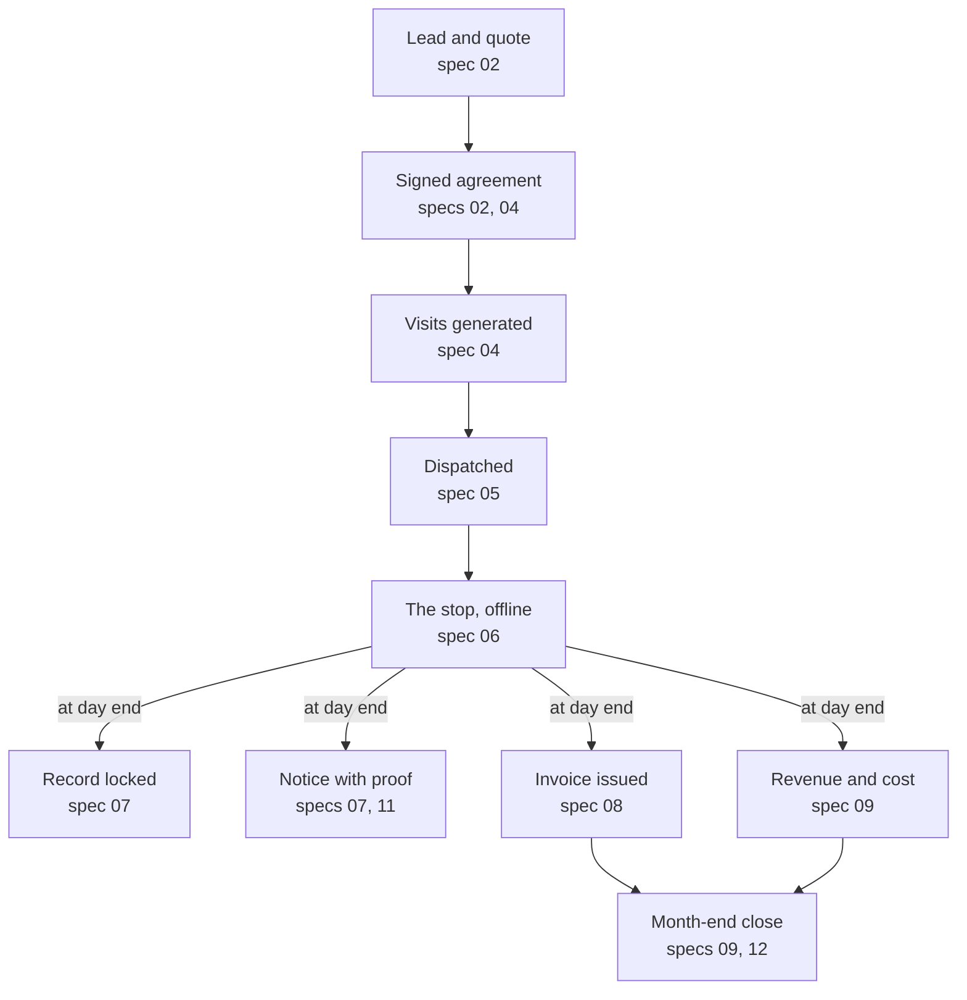
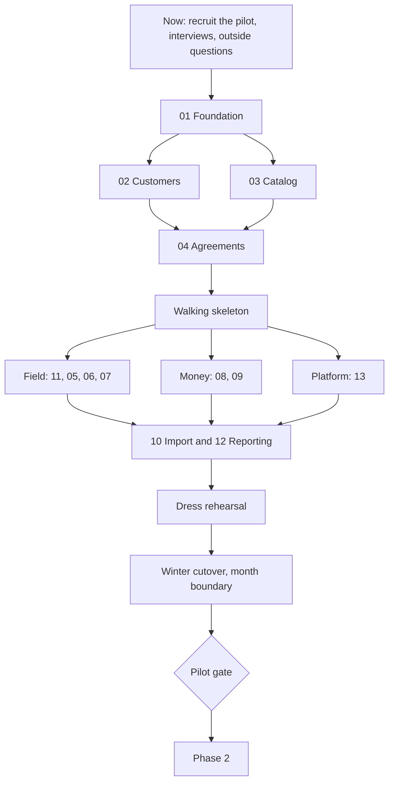

> **Source of truth.** This file is the Bugsy PRD. The interactive PRD site is built from it and from the feature data in `docs/competitors/` (`feature-taxonomy.json`, `bugsy-plan.json` and one profile per competitor), so the PRD and the feature crosswalk share one feature list. Edit here, then run `python3 -I docs/prd-site/build.py` to rebuild the site. The October 29 Claude Doc draft and the October 20 crosswalk page are superseded by this file and the site. HTML comments such as `page:` and `widget:` mark where site pages start and where interactive views go; GitHub hides them.

# Bugsy PRD

Version 2 · October 30, 2026 · Phil Klejwa

<!-- page: overview | Overview -->

## Summary

Bugsy should win Wisconsin pest companies by making compliance and correct books a by-product of finishing a stop, while matching the table stakes every competitor already has. Version 2 folds in a fresh competitor and market research pass from October 29, 2026: nine competitors scored on one 80-feature checklist, the Wisconsin market sized from Census and BLS data, and what pest software vendors earn.

<!-- widget: kpis -->

- **The wedge holds.** None of the 9 competitors scored (the original 8 plus Fieldwork), nor about ten other pest tools scanned, names Wisconsin, sends regulatory pesticide notices, enforces restricted-use rules, or keeps a double-entry ledger with deferred revenue per agreement. No 2025 to 2026 competitor roadmap targets these.
- **Table stakes are universal.** A map dispatch board, mobile app, field payments, autopay and standard reports are offered by all 9, some only on higher tiers. Reminder and on-the-way texts are offered by 7 of 9, and at least 6 of those charge extra for texting.
- **Fieldwork is the closest rival.** It is a pest-first Illinois product with two Wisconsin customers and the only software exhibitor at the 2026 Midwest PestCon. It already sells per-technician pricing with free office users, below Bugsy's proposed price.
- **First tenant:** a single-branch, residential-first Wisconsin company with 3 to 15 technicians. About 32 to 37 Wisconsin firms fit.
- **Wisconsin is the proof market, not the business.** At $79 to $99 per technician, Wisconsin tops out near $1M a year even at full share. The second state needs choosing now.
- **Pricing needs rework.** "Published prices" and "per technician" are no longer unique; "all-inclusive" still is. A base plus per-technician price, counted at a trailing peak, is proposed for testing.
- **Phase 1 gate:** 30 consecutive business days of real operations on Bugsy, with every application record locked the same day and every required notice sent on time.
- **Decisions:** 15 calls, each with a recommendation, and 7 outside answers with deadlines tied to the Wisconsin season.

"Bugsy" is a working name taken from the repository.

<!-- page: market | Market -->

## Problem and why now

Wisconsin pest companies run a recurring, regulated business on software built for generic field service or for other states. The cost lands on four people.

| Who | Today | What it costs them |
| --- | --- | --- |
| Owner | Software shows invoices, not contract positions; the books live in QuickBooks with an outside accountant | Revenue looks smooth while costs land in service months; a cancellation right after a visit leaks delivered but unbilled service; retention, route density and re-service cost stay invisible |
| Licensed manager | ATCP 29 records, notices, the landscape registry and license dates kept on paper, spreadsheets or generic chemical logs | Hours of record keeping and no proof that every notice went out. Inspections are rare (96 record inspections across 2,412 licensed locations in 2025), but a missed notice or unlicensed assignment still puts the license at risk |
| Technician | Retyping visit details. Housecall Pro is view-only offline; GorillaDesk caches only the current week and cannot edit job details offline. PestPac and Fieldwork claim full offline completion, but reviewers report sync failures | Lost time in basements and rural areas; incomplete or lost legal records |
| Office | Billing modes, winter skips, price increases and cancellations handled by hand | Errors at the most sensitive customer moments: the bill and the cancellation |

**Why now**

- **Nobody covers Wisconsin.** State formats are spreading: California and New York (PestPac, Fieldwork), Arizona (PestPac, Pocomos), and Briostack claims WDI/WDO forms for all 50 states. None covers ATCP 29 records, registry notices or posting.
- **Competitors are investing elsewhere.** Every competitor's 2025 to 2026 releases went to AI, analytics, payments and sales. None added compliance or accounting depth.
- **Buyers resent add-on fees and tier gating.** 5 of 9 now publish prices, so opacity matters less than what is left out of the base plan. Bugs after updates remain a common complaint. PestPac feeds QuickBooks through a periodic export, not a live sync.
- **Horizontal tools are cheap at entry, not for pest work.** Reminders and autopay need Jobber Connect, recurring service plans need Housecall Pro MAX, Jobber's chemical log is web-only, and Housecall Pro offers a printable paper log.
- **Residential growth is tightening.** Rollins reported 3.6% residential organic growth in Q2 2026 with falling lead volume, which raises the value of retention, re-service and contract-position reporting.
- **ServSuite's sunset is a minor point in Wisconsin.** FieldRoutes is moving ServSuite users in incentive cohorts with no public deadline. No remaining Wisconsin ServSuite user was found; Kwik Kill of Madison moved to FieldRoutes in 2023.

## The Wisconsin market

Wisconsin is small and consolidating: 146 employer pest control firms with $148.4M in receipts in 2022, and national brands hold 48% of those receipts. Census code 561710 excludes lawn care, so these figures are pest control only.

| Measure | Value | Year | Source |
| --- | --- | --- | --- |
| Employer firms | 146 | 2022 | [Census SUSB](https://www2.census.gov/programs-surveys/susb/tables/2022/us_state_6digitnaics_2022.txt) |
| Employer receipts | $148.4M | 2022 | Census SUSB |
| Establishments | 184 | 2023 | [Census CBP](https://www2.census.gov/programs-surveys/cbp/datasets/2023/cbp23st.zip) |
| One-person businesses | 269, with $16.0M receipts | 2024 | [Census Nonemployer](https://www2.census.gov/programs-surveys/nonemployer-statistics/datasets/2024/historical-datasets/nonemp24st.zip) |
| Average employment | about 1,550, up 24% since 2023 | 2025 | [BLS QCEW](https://data.bls.gov/cew/data/api/2025/1/industry/561710.csv) |
| Technicians (estimate) | about 940 (805 at the February low, 1,075 at the June peak) | 2025 | National technician share applied to QCEW |
| Share held by national firms | 48% of receipts | 2022 | Census SUSB |
| Firms with 5 to 9 employees | 19, about $873K receipts each | 2022 | Census SUSB |
| Firms with 10 to 19 employees | 13, about $1.79M receipts each | 2022 | Census SUSB |
| Licensed pesticide business locations (all categories) | 2,412 | 2025 | [DATCP annual report](https://datcp.wi.gov/Documents2/2025ACMAnnualReport.pdf) |
| Landscape registry addresses | 3,576 | 2025 | DATCP annual report |

- **Target pool.** The 3 to 15 technician band is about 32 to 37 firms, all single-location. The first 10 tenants would be roughly 30% of it.
- **DATCP counts mislead.** The 2,412 licensed locations cover farm, turf, right-of-way and structural together, about five times the pest establishments Census counts. Ask DATCP for 7.1 and 7.3 counts rather than using the total.
- **Consolidation.** In 2025 Greenix bought Spidexx's Milwaukee office and Rove's Milwaukee and Madison operations, Plunkett's bought Horizon of Milwaukee, and Ecolab bought Guardian. Wil-Kil and Batzner already belong to Rentokil Terminix. Acquired firms move to the buyer's software, so the independent pool shrinks.
- **Seasonality.** Wisconsin pest employment peaks at 1.33 to 1.44 times its winter low, against about 1.1 nationally. Mosquito service is mainstream: 16 of 38 sampled independents advertise it.

**Revenue ceiling.** The calculator applies a monthly price per technician to each pool. At $79 to $99, all of Wisconsin is about $0.89M to $1.12M a year at full share, independents alone about $0.54M to $0.68M, and the target band about $175K to $330K. The four neighbors (Minnesota, Illinois, Michigan, Iowa) have 770 employer firms and $1.11B in receipts, about 7.5 times Wisconsin; Illinois alone has 330 firms and $527.1M. Nationally, 13,603 firms employ about 89,070 pest control workers.

<!-- widget: market -->

Wisconsin proves the product; it cannot carry the business. Choose and size the second state before pricing is final. Illinois holds the largest nearby pool of independents.

<!-- page: customers | Customers -->

## Who we build for first

Recommendation: the pilot and the first 10 tenants are independent, residential-first Wisconsin pest companies with one branch and 3 to 15 technicians.

- Manual dispatch with simple sequencing (Phase 1) works at this size; route optimization matters more above it. GorillaDesk Basic and Pocomos include route optimization at this size, so sales needs a prepared answer.
- The owner is usually also the licensed manager, so the buyer feels the compliance pain directly and decides quickly.
- There is no dedicated compliance or accounting staff, so automation replaces work nobody has time for.
- Mid-size multi-branch firms expect route optimization, commercial audit tools, commissions and deep reporting on day one. Serving them first pushes the pilot out by a phase.

**What they run today.** Of 38 independent Wisconsin websites sampled, 30 show no identifiable software, which fits spreadsheets or paper. Where software is visible: GorillaDesk at 3 (Bourn, Nexus, 1st Choice Pest Control of Appleton), Fieldwork at 2 (1st Choice Pest Solutions of Eau Claire, On Target of La Crosse), PestPac, Briostack and Service Autopilot at 1 each, and FieldRoutes at Kwik Kill. In Bugsy's first deals the incumbents are Fieldwork, GorillaDesk and FieldRoutes.

**Not first:** owner-operators with 1 or 2 technicians (price-led buyers; Fieldwork starts at $39 plus $19 per technician and GorillaDesk at $49, and both also serve 3 to 15 technician firms), multi-branch regionals, national brands and lawn-care-first companies (out of scope). The data model stays multi-branch, as spec 01 already plans.

| Persona | Role keys | Job to be done | Phase 1 must deliver |
| --- | --- | --- | --- |
| Owner and licensed manager | owner, compliance_manager | Know the business is healthy and legal | Owner dashboard, AR, renewals, credential alerts, inspector export |
| Office manager, often also the dispatcher | office, dispatcher | Sign customers, fill routes, bill, answer the phone | Customer and agreement screens, dispatch board, billing, messaging |
| Technician | technician | Finish each stop fast and never enter anything twice | Offline app, product picker, notices handled in the flow, payments |
| Outside bookkeeper | bookkeeper | Close the month | Journal, deferred revenue roll-forward, export for QuickBooks |
| Residential customer | none in Phase 1 | Know when the technician comes and pay easily | Reminders, on-the-way text, service summary, pay link |

**Where to find them.** The Wisconsin Pest Control Association's Midwest PestCon runs February 9 to 10, 2027 in Wisconsin Dells. The 2026 edition drew about 190 participants and 26 exhibitors, and Fieldwork was the only software company there. The WPCA board lists independent owners from Safeway, Kwik Kill, Belle City, Bourn, Professional Pest Control and BugBoss. With Mosquito Police of Antigo (GorillaDesk), 1st Choice Pest Solutions and On Target (Fieldwork) and Werner (Briostack), that is an interview list covering every visible incumbent.

<!-- page: competitors | Competitors -->

## Competitors

Nine products are scored on the feature checklist: the original eight plus Fieldwork. Select one below to see its profile and every score with its source.

| Product | Owner | Focus | Wisconsin presence | Threat to the first deals |
| --- | --- | --- | --- | --- |
| Fieldwork | Fieldwork Software (linked to Anstar Products), Niles, Illinois | Pest first; also markets lawn and pool | 2 customers; only software exhibitor at Midwest PestCon 2026 | High: same pricing model, lower price, local channel |
| GorillaDesk | Private | 29 trades, customers skew pest | 3 customers; Mosquito Police of Antigo | High: cheap, well liked, serves 3 to 15 technician firms |
| FieldRoutes | ServiceTitan | Pest and lawn | Kwik Kill of Madison (15 technicians) | Medium: deeper product, opaque price |
| PestPac | WorkWave (EQT) | Pest only | Fenix; roll-up buyers (Greenix) use it | Medium in roll-ups, low with independents |
| Briostack | EverCommerce | Pest and lawn | Werner | Medium: new licensing and state-form claims |
| Pocomos | Private | Residential pest, door-to-door | None found | Low: now publishes month-to-month prices |
| ServSuite | ServiceTitan (being phased out) | Pest, lawn, tree | None found | Low: users are moving to FieldRoutes |
| Jobber | Private | Many home-service trades | None found | Low to medium: polished, but thin pest depth |
| Housecall Pro | Private | Many home-service trades | None found | Low: recurring plans only on its top tier |

<!-- widget: dossiers -->

**Pest-only vendors are the smaller ones.** PestPac is the one large pest-only product, and it sits inside a multi-industry company. FieldRoutes, the largest pest outcome, added lawn care. Bugsy's pest-only scope is defensible because its edge does not depend on more trades, but pest-and-lawn firms (for example Pest Badger, on Service Autopilot) will need a second system for lawn work. Decision 15 asks whether pest-only is permanent.

**What pest software vendors earn.** No vendor reports pest revenue on its own; the firmest numbers are acquisition prices and Jobber's statements.

| Vendor | Best available figure | How solid |
| --- | --- | --- |
| Jobber | Over $100M annual revenue in 2022 (CEO); probably about $200M now | 2022 reported; current derived |
| Housecall Pro | Roughly $70M to $160M from 45,000 businesses at list prices; valued at $1.12B in 2022 | Derived |
| WorkWave (PestPac's owner) | Over $400M in 2022, across lawn, cleaning, security and payments too; PestPac claims 2,300+ pest companies | Company total reported; PestPac share undisclosed |
| FieldRoutes | ServiceTitan paid $576.9M in February 2022; third-party revenue estimates $10M to $16M, low confidence | Price from SEC filings |
| Briostack | EverCommerce paid $35.2M in January 2021, with about 650 pest customers | Price from SEC filings |
| GorillaDesk | Roughly $4M to $13M from 7,200+ teams at $49 to $149 a month | Derived, low confidence |
| Pocomos, Fieldwork | Probably low single-digit millions | Third-party estimates |

Pest-only vendors seem to land between about $2M and $20M a year; only the multi-trade platforms clearly pass $100M. About a quarter of ServiceTitan's latest quarterly revenue ($72.1M of $292.8M) is usage revenue, mostly payments, which is how larger vendors grow past seat pricing.

**Watch list (not scored).** Service Autopilot (Xplor; Pest Badger in Wisconsin), PestBase.ai (feature list closest to Bugsy's compliance list; owner unknown), Smart Service (a QuickBooks add-on with EPA-level records), WorkWave Service, and small pest tools (PestBoss, PestfocusPro, PestScan). AI receptionists such as Avoca (valued at $1B in April 2026) sit on top of a system like Bugsy and connect through APIs.

<!-- page: features | Features -->

## The feature list

One checklist of 80 features drives both Bugsy's plan and the competitor comparison, so the PRD and the crosswalk cannot drift apart. Each feature carries Bugsy's phase and spec, and each competitor's score with a source.

- **Table stakes (13 features)** are features most competitors have and buyers expect on day one. Bugsy plans all but two for Phase 1: route optimization is Phase 2 and the customer portal is Phase 2 (Phase 1 has a pay link and emailed summaries).
- **The wedge (13 features)** is where few or no competitors offer full support. Its lasting core is Wisconsin-complete records and notices plus per-agreement contract accounting. The edges are softer: Fieldwork fully meets the product catalog, skills matching is spreading toward license-based assignment, and PestPac and FieldRoutes announced churn analytics in October 2026.
- **Scores** follow one rule: Yes means built in and documented by the vendor. "Not confirmed" means not found in public documentation, not proven absent.

<!-- widget: matrix -->

<!-- page: goals | Goals -->

## Goals, non-goals and success metrics

Phase 1 succeeds when one pilot company runs its daily operations on Bugsy and its owner would pay for it.

**Goals**

1. Run a residential route end to end: sign, schedule, service, bill, book.
2. Produce a complete ATCP 29.21 record for every application on the same day, with no separate form.
3. Keep proof that every required notice went out on time.
4. Book revenue, deferred revenue and unbilled receivables per agreement exactly as the ledger fixtures define.
5. Never expose one tenant's data to another.

**Not in Phase 1:** route optimization, customer portal logins, commercial device maps and audit binders, termite graphs and warranties, multi-visit wildlife and bed bug workflows, the door-to-door app, commissions, payroll, QuickBooks API sync, bank feeds, AI features, the public website, a second state, importers for other pest software, and billing tenants for the software.

**Pilot gate** (proposed targets, to confirm with the pilot)

| Metric | Target | Measured by |
| --- | --- | --- |
| Days on Bugsy | 30 consecutive business days; no parallel system for scheduling or billing | Visits dispatched and closed in Bugsy |
| Same-day records | 100% locked by the end of the application day | application_records.locked_at against the visit date |
| Post-application notices | 100% sent within 30 days through a consented channel | notices.sent_at against due_by |
| Landscape advance notices | 100% recorded before the start at registry addresses | notices against visits.arrived_at |
| Offline capture | 0 lost visits; at least 99% sync with no manual fix | Sync log |
| Technician time per stop | Median under 3 minutes in the app, beyond the work itself | App timestamps plus before and after interviews |
| Billing | 100% of invoices issued from Bugsy | invoices |
| First month-end | Contract positions follow the fixture method; the pilot's accountant signs off | Deferred revenue roll-forward |
| Isolation | test:rls green on every merge; 0 incidents | CI |
| Value | Owner agrees to pay the proposed price after the pilot, priced against Fieldwork and GorillaDesk | Exit interview |

After the pilot, track tenants live, recurring revenue, logo churn, days from import to first route, and support tickets per tenant per month.

## Core journeys in Phase 1

The main journey runs from a lead to a closed month, and the technician's stop is where it pays off: one capture produces the legal record, the notice, the invoice and the journal entries.

<!-- widget: journey -->

The other journeys the pilot needs:

1. **Cancellation:** reason code and save offer; then stop autopay, cancel future visits, settle the contract balance per the terms, and bill any cancellation fee as its own line (specs 04, 08, 09).
2. **Re-service:** the customer calls, and the office books a $0 visit on the agreement; labor and product cost still post (04, 05, 09).
3. **Winter:** skipped months and interior-only visits, with flat monthly billing kept steady (04, 08).
4. **Inspection:** the compliance manager exports records, notices and licenses for a date range (07).
5. **Go-live:** import customers, properties, agreements and opening balances through a dry run, then dispatch the first routes (10).

<!-- page: build | Build plan -->

## Phase 1 requirements by spec

The specs hold the detail; this table sets what each must deliver for the pilot and proposes an answer to every question in its stub, so each `/write-spec` interview starts from a position. "Stretch" means Phase 1 only if time allows. Specs 11 to 13 are proposed.

| Spec | Must have for the pilot | Recommended answers to the stub questions |
| --- | --- | --- |
| 01 Foundation | Tenancy, RLS, roles, branches, audit, tenant switcher, seed data | Ready as written. Logged, time-limited support access moves to spec 13 |
| 02 Customers | Accounts, properties, contacts with a resident role, leads with a required source, quotes, conversion, geocoding on save | Good, better, best quote groups: stretch. Default lead sources: phone, referral, door to door, online directory, ads, website, other; tenants add their own. One provider for address validation, map pins and tax jurisdiction. Duplicates: warn on the same normalized address, phone or email; never auto-merge |
| 03 Catalog | Service types with tax class, certification categories, landscape flag and job kind; price book with square-foot tiers and add-ons; master product list with EPA number, label and SDS; tenant enable and cost | Master list at launch: entered by hand from the pilot's own product list, then grown tenant by tenant. Tiers by square footage; lot size only for yard mosquito and tick. Tenant-added products: yes, with a required EPA registration number and an unverified flag until a platform admin approves |
| 04 Agreements | All cadences and seasonal rounds, initial visit, $0 re-services, three billing modes, winter skips, terms and auto-renew, cancellation with reason codes | Generate the whole term's visits as planned rows at signing; flat-monthly totals need the count. A cadence or price change regenerates only future unscheduled visits. Renewals: auto-renew per agreement plus an office renewal list 30 days ahead. Bulk yearly price increase: stretch, needed before the pilot's first renewal season |
| 05 Dispatch | Technician rows by day columns with a map pane, drag and drop, order within a day, every compliance check (license year, category, expiry, trainee supervision, restricted use, bat blackout, registry notice), move a technician's whole day | Customer time windows (morning, afternoon): stretch. Bulk reschedule: must have, because Wisconsin weather moves whole days |
| 06 Technician app | Offline installable web app, today's route, arrival and departure, product capture, notices and signs in the flow, photos, notes, signature, completion blocked by missing record fields, field payments | Sync conflicts: the office owns the schedule; the technician owns what was captured at the stop; an office edit to a started visit is held for review. Day-one device features: camera and GPS, no printing. Field payments: cash, check, card on file and a texted pay link; card readers later |
| 07 Compliance | Credentials with 60 and 30 day alerts, record lock and amendments, notice engine and log, registry import, inspector export, year-end license renewal task | Registry: CSV upload with column mapping until DATCP's format is known. Export: one PDF for the inspector plus a CSV bundle. Amendments: compliance manager or owner, with a reason; the original stays visible |
| 08 Billing | Stripe Connect onboarding, invoices in all three billing modes, one statement per account, card and ACH autopay, retries, past-due flag, tax engine with every pest service type nontaxable until DOR answers, cancellation settlement | Standard-style connected accounts with direct charges, so the tenant owns its Stripe relationship and losses. Platform fee: built, set to zero for the pilot. Numbering: one sequence per tenant. Late fees and commercial PO and net terms: stretch |
| 09 Ledger | Chart of accounts template, posting engine, contract balance per agreement, period-end reclass, trial balance, P&L, balance sheet, deferred revenue roll-forward, period close, branch-level chemical receipts and usage, summarized journal export for QuickBooks | Reopen a closed period: owner only, logged. Allocation: visit list price by default; an accountant confirms before the spec interview |
| 10 Import | CSV templates for accounts, properties, contacts and agreements; dry run with row-level errors; opening AR per account; opening contract balance per agreement | Required fields: the minimum to schedule and bill (name, service address, service type, cadence, price, billing mode, next due date). History: keep pre-Bugsy records as uploaded files for the 2-year retention, not as structured records |
| 11 Messaging (proposed) | Email and SMS sending layer: templates, opt-in and STOP handling, day-before reminders, on-the-way texts, post-service summaries, invoices and receipts, delivery status as notice proof | Texting included in the base price. Start carrier registration (A2P 10DLC or toll-free verification) when the pilot signs. Two-way SMS: decide in the spec interview |
| 12 Reporting (proposed) | Owner dashboard: active agreements, recurring revenue run rate, cancellations and retention by service line, route and technician, stops per day, re-service rate and cost, AR aging, notices due, credentials expiring | Ships before the pilot gate; ship retention first, since PestPac and FieldRoutes have announced churn analytics |
| 13 Platform operations (proposed) | Logged, time-limited support access; tenant onboarding checklist; platform admin for the shared product catalog; tenant data export; records kept available 2 years after a tenant leaves | Needed before pilot go-live |

## Gaps in the build plan

The original 10 specs cover the core, but a pilot would hit these gaps in its first week. Specs 11 to 13 (above) close three of them; the rest change existing specs or the data model.

1. **Visits need a crew, not one technician.** A trainee needs a certified applicator on site, and both the record (ATCP 29.21) and the customer notice (29.22) name everyone who applied or directly supervised. Add `visit_technicians` (visit, user, role: applicator, supervisor or helper) and keep `visits.technician_id` as the lead. Affects 04 to 07.
2. **The 10-foot rule must be known when scheduling.** The 12-hour registry notice goes out before the stop, so a treatment that reaches beyond 10 feet belongs on the agreement or service type as the planned extent. The app warns when captured work goes further than planned at a registry address. Also add `service_types.job_kind` (for example `bat_exclusion`), which the scheduling fixture uses but the data model lacks. Affects 03 to 06.
3. **Routes need an order.** Visits carry a technician and a date but no sequence. Add `visits.route_position`, or a `routes` table (technician, date, start location) if routes need their own attributes. Affects 05 and 06.
4. **Printing at the stop is unreliable.** An installed web app on iPhone cannot reach Bluetooth printers, and AirPrint needs a compatible printer in every truck. Phase 1: Bugsy generates per-tenant door hanger and ATCP Appendix D sign templates for pre-printing; the technician fills one in, posts it and photographs it as proof. Consented residents also get an electronic copy. Affects 06 and 07.
5. **Opening contract balances.** Agreements already mid-term on flat monthly or annual prepay carry deferred revenue or an unbilled receivable. Import billed-to-date and delivered-to-date per agreement, or month one of the ledger is wrong. Affects 09 and 10.
6. **Chemical inventory has no owner.** The posting fixture credits `chemical_inventory` when product is used, which assumes receipts are recorded. Recommend minimal branch-level receipts and usage in spec 09, with truck stock and transfers in Phase 2. Changing the posting rule instead would be a deliberate fixture change.
7. **Field payments.** All 9 competitors have them. Cash, check, card on file and a texted pay link fit a web app; card readers and tap to pay need a native wrapper, so they wait. Affects 06 and 08.
8. **License-year rollover.** Licenses end December 31. If go-live is in January, 2027 license numbers must be entered first, or the license check blocks every assignment. Spec 07 gets a year-end renewal task.

## Non-functional requirements

Isolation, offline reliability and legal timestamps matter more here than speed. Numbers marked proposed are starting targets.

| Area | Requirement |
| --- | --- |
| Tenant isolation | RLS on every tenant table; `npm run test:rls` runs in CI on every merge; the service role key never reaches a browser |
| Payments security | Card data only in Stripe-hosted fields (PCI SAQ A scope); no card numbers in our database or logs |
| Audit | Audit rows on memberships, roles, settings, credentials, records, amendments and period closes; journal entries are reversed, never deleted |
| Support access | Platform staff see tenant data only through a logged, time-limited grant that the tenant can see |
| Offline | Captured visit data is durable on the device before the technician leaves the stop; sync is idempotent with client-generated ids; a full day of stops with photos works with no signal. Sell reliability (zero lost visits), since competitors already claim offline |
| Devices | The technician app runs on the pilot's actual phones: iPhone installed to the home screen and Android Chrome, current and previous OS. Confirm the models before spec 06 |
| iOS web app limits | Safari has lacked Background Sync, Web Bluetooth and the BarcodeDetector API. Sync on open and on reconnect, use a JavaScript barcode decoder, and avoid any printer dependency. Spike these in week 1 of spec 06, with a native wrapper (for example Capacitor) as the fallback |
| Integrations | A public API or webhooks in Phase 2, so AI receptionists and assistants can connect; Jobber, GorillaDesk and Fieldwork shipped AI connectors in 2026 |
| Time | Timestamps in UTC; business dates in the tenant time zone (America/Chicago). Tests cover daylight saving changes, because record start and end times are legal data |
| Performance (proposed) | Dispatch board for 15 technicians over 2 weeks loads in under 2 seconds; the technician app opens today's route offline in under 1 second |
| Retention | Application records and notice proof kept at least 2 years (value read from the rules file), including after a tenant cancels |
| Backup | Point-in-time recovery on the production database, and a restore drill before go-live |
| Accessibility | Office app to WCAG 2.1 AA; technician app usable with gloves and in sunlight (large targets, high contrast) |
| Data ownership | A tenant can export all of its data as CSV at any time |

<!-- page: pricing | Pricing -->

## Pricing and packaging

Recommendation: keep everything included (compliance, billing, the general ledger, texting up to a monthly allowance), no setup fee, month to month, and published prices. Change the price unit from a flat price per active technician to a base price plus a price per technician, with technicians counted on a trailing 12-month peak and crew helpers and trainees free. The price points are a hypothesis to test in interviews before Midwest PestCon (decision 6).

Why the unit should change:

- **The original hypothesis is high.** At $79 to $99 per technician, an 8-technician company pays $632 to $792 a month: 1.4 to 1.8 times Fieldwork Pro and more than every published option except Fieldwork Enterprise. At 3 technicians the gap is wider ($237 to $297 against $197 for Fieldwork Pro).
- **Per technician is not new.** Fieldwork already bills only field users with office users free, and GorillaDesk bills per route. "All-inclusive" is what still sets Bugsy apart: Fieldwork gates service agreements and routing to Pro and skills matching to Enterprise, and at least 6 of 9 competitors charge for texting.
- **"Active" technicians swing with the season.** Wisconsin employment peaks at 1.33 to 1.44 times its winter low, so a monthly active count recreates the swing the PRD criticizes in Pocomos's per-customer pricing.
- **Crews would pay twice.** GorillaDesk bills a crew once, and Bugsy's own `visit_technicians` change makes trainee-plus-applicator crews common.
- **The cost is affordable; the comparison is the problem.** $632 a month is about 0.45% to 0.55% of revenue for an 8-technician firm earning about $1.7M.

An illustration to test (not a research finding): $149 plus $69 for each technician after the first gives $287 at 3 technicians, $632 at 8 and $1,115 at 15, undercutting Fieldwork Enterprise at every size. Try other numbers in the calculator.

<!-- widget: pricing -->

| Competitor | Pricing model | Published or reported price |
| --- | --- | --- |
| Fieldwork | Base plus each extra technician; office users free; month to month | Solo $39 + $19, Startup $59 + $29, Business $79 + $39, Pro $99 + $49, Enterprise $149 + $79; texts $0.03 each plus $5 a number |
| GorillaDesk | Per route, a crew pays once, unlimited users | Basic $49, Pro $99, Growth $149 including 1 route; extra routes $30 to $100; SMS $5 a month plus credits |
| Pocomos | Active and on-hold recurring customers, unlimited users, month to month | $109 (0 to 20 customers) to $275 (301 to 500), then $0.16 per customer over 500; SMS $4 a month plus $0.04 a text |
| Jobber | Tier plus users | $29 to $699 a month by tier, billing term and users; extra users $29; reminders and autopay from Connect |
| Housecall Pro | Tier with user caps | $59 to $299 a month on annual billing; recurring service plans only on MAX ($299 annual, 8 users, +$35 per user) |
| FieldRoutes | Active customers, quote only | Vendor says "Request Pricing"; G2 lists $350 per 1,000 active customers |
| PestPac | Per user, quote only, annual contract | Third-party estimate about $100 per user a month (range $80 to $150), June 2026 |
| Briostack | Concurrent active users, quote only | Not verifiable; one-year auto-renewing term with an early-termination fee |
| ServSuite | Quote only | Not verifiable |

**Payments.** No platform fee during the pilot. Add a per-payment fee later only if the tenant's total processing cost stays at or below what it pays today: cards at 2.9% plus 30 cents (Jobber; GorillaDesk on Stripe) or from 2.59% (Housecall Pro), ACH at 1%. Payments are how larger vendors grow, so treat this as the second revenue line after the pilot.

<!-- page: rollout | Rollout -->

## Pilot and rollout

Build in the kit's order, but prove the whole loop right after spec 04, run field and money work in parallel, and cut over in winter.

<!-- widget: rollout -->

- **Now:** recruit the design partner and book 3 to 5 interviews from the list under Customers, including Fieldwork and GorillaDesk users. Send the outside questions. Set pricing before Midwest PestCon on February 9 to 10, 2027, and exhibit there.
- **Walking skeleton:** one agreement pushed through a visit, a locked record, a notice, an invoice and a journal entry, thin but real. The kit slices by module, so integration problems would otherwise surface last.
- **Messaging first in the field track:** reminders and the post-service notice depend on it, and SMS registration has a lead time.
- **Winter, on a month boundary:** volume is lowest, so mistakes are cheaper, and opening contract balances start clean. The spring sign-up and mosquito rush then tests a system that already works. This needs 2027 licenses entered before go-live and the mosquito tax answer before spring.
- **Second state:** choose it during the build, so the rules-as-data design, the price unit and the PestCon pitch are set once.

<!-- page: risks | Risks -->

## Risks

The biggest risks are scope (13 specs before a pilot can run a day) and market size (Wisconsin alone tops out near $1M a year).

| Risk | What happens | Mitigation |
| --- | --- | --- |
| Phase 1 is too big for the pilot window | The pilot slips into or past the spring rush | Walking skeleton first; hold stretch items; gate on journeys, not on spec count |
| Wisconsin is too small to carry the business | About $1M a year at full share; about three dozen firms in the target band | Choose and size the second state now; Illinois has the largest nearby pool |
| Roll-ups shrink the independent pool | Acquired firms move to the buyer's software | Prioritize firms outside Milwaukee and Madison; move fast on the interview list |
| Fieldwork adds Wisconsin records | The compliance lead narrows; Fieldwork already produces California and New York reports | Ship notices and contract accounting, which are harder to copy than a record format |
| Rivals ship retention analytics first | PestPac and FieldRoutes announced churn analytics in October 2026 | Ship spec 12's retention view early; do not lead the pitch with it |
| Owners and accountants keep QuickBooks as the ledger | The GL is a cost without a selling point | Summarized journal export in Phase 1; pitch contract positions and cancellation settlement, not the ledger itself |
| Price is above the local incumbents | Lost deals to Fieldwork and GorillaDesk | Test the base plus per-technician structure; sell what it replaces (the notice log and the deferred-revenue spreadsheet) |
| iOS web app limits (sync, camera scanning, storage, printing) | The technician app frustrates the people it most needs to win | Spike on the pilot's phones in week 1 of spec 06; native wrapper as the fallback |
| SMS registration lead time | No texts at go-live | Start registration when the pilot signs; email as the fallback |
| Unanswered regulatory questions | Wrong blocks, wrong tax, missed notices | Rules as data in `lib/compliance/rules/wi.ts`; conservative defaults (block, do not tax, require notice); owners and deadlines under Decisions |
| An e-signed consent may not count as "prior written consent" under ATCP 29.22 | Electronic notices are invalid and paper is needed | Confirm with counsel or DATCP; Wisconsin's electronic transactions law (Wis. Stat. ch. 137) likely covers it |
| Accounting policy changes late (allocation method, inventory) | Rework in spec 09 | Accountant review before the spec 09 interview |
| Cross-tenant data leak | Loss of trust, fatal for a multi-tenant product | RLS, the isolation suite, migration hooks, the spec-reviewer agent |
| One design partner shapes the product too narrowly | A fit for one company only | 3 to 5 interview companies alongside the pilot |
| Stripe onboarding delays for a tenant | No payments at go-live | Start Connect onboarding during setup, weeks before cutover |

<!-- page: decisions | Decisions -->

## Decisions needed

Fifteen calls shape Phase 1. The first three should be made before spec 01 starts, and pricing (6) before Midwest PestCon.

| # | Decision | Recommendation | Blocks |
| --- | --- | --- | --- |
| 1 | First tenant profile | Single branch, residential first, 3 to 15 technicians | Pilot recruiting, spec 02 interview |
| 2 | Design partner | Recruit before the spec 02 interview, from the WPCA and incumbent-user list | Specs 02 to 10 |
| 3 | Stack | Confirm Next.js, Supabase and Vercel, as the kit assumes | Spec 01 |
| 4 | General ledger default | Bugsy's GL is the system of record, with a summarized journal export for QuickBooks in Phase 1 and API sync in Phase 2 | Spec 09 |
| 5 | Stripe Connect | Standard-style accounts, direct charges, platform fee built but zero | Spec 08 |
| 6 | Software pricing | Base plus per technician, counted on a trailing 12-month peak, crew helpers and trainees free, texting included, no setup fee | Midwest PestCon, February 9, 2027 |
| 7 | Field payments | Phase 1: cash, check, card on file, texted pay link | Spec 06 |
| 8 | Customer messaging | Add spec 11 | Specs 06 and 07 |
| 9 | Reporting | Add spec 12 | Pilot gate |
| 10 | Visit crew | Add `visit_technicians` | Data model for specs 04 to 07 |
| 11 | Resident notices and signs | Pre-printed templates with photo proof; electronic copies to consented residents | Specs 06 and 07 |
| 12 | Inventory | Branch-level receipts and usage in Phase 1; truck stock in Phase 2 | Spec 09 |
| 13 | Cutover | Winter, on a month boundary, after 2027 licenses are entered | Pilot plan |
| 14 | Second state | Choose and size it during the build; start with Illinois | Pricing, rules-as-data design |
| 15 | Pest-only scope | Pest-only for Phase 1 and 2; revisit lawn care only if pest-and-lawn firms block deals | Sales positioning |

**Outside answers**

| Question | Ask | Needed by |
| --- | --- | --- |
| Is yard mosquito and tick spraying taxable? | DOR | Before the first mosquito invoice, spring 2027 |
| Which certification category covers yard tick control? | DATCP | Before tick service types are set up for the pilot |
| What format is the landscape registry distributed in? | DATCP | Before the spec 07 interview |
| What does NR 12.10 require of a hired wildlife operator, and may one work under a landowner's bat health exemption? | DNR | Before wildlife jobs are scheduled (Phase 1 blocks the blackout anyway) |
| Do state holidays count as business days for mailed landscape notices? | DATCP | Before spec 07 |
| Does an e-signed consent meet ATCP 29.22's "prior written consent"? | Counsel or DATCP | Before the e-sign flow in spec 02 or 04 |
| How many businesses hold 7.1 Structural and 7.3 Termite licenses? | DATCP (608-224-4548) | Before pricing is final |

<!-- page: sources | Sources -->

## Sources and method

- **Discovery:** the [discovery spec](https://claude.ai/artifact/PZvWbg1f2PkV4NJK7QjFqb) (business model, Wisconsin rules, module answers), exported to `docs/discovery-spec.md`.
- **Competitor profiles:** one JSON file per product in `docs/competitors/`, researched October 20, 2026 and corrected October 29 and 30, 2026, each score with a source link. Public sources only: vendor pages, help centers, release notes, pricing pages, app stores and review sites.
- **Research notes and report:** `research_notes/Competitor research vs Bugsy PRD/` and `reports/Competitor research vs Bugsy PRD.md`.
- **Market data:** Census Statistics of US Businesses 2022, County Business Patterns 2023 and Nonemployer Statistics 2024 for NAICS 561710; BLS QCEW 2025; DATCP's 2025 annual report.
- **Limits:** G2, Capterra and Reddit blocked direct reading, so some ratings come from search summaries. The Wisconsin technician count is an estimate from the national share. Revenue figures for private vendors are estimates or derived, as labeled.

<!-- page: none -->

## Appendix: feature plan

Generated from `docs/competitors/bugsy-plan.json` and the competitor profiles by `docs/prd-site/build.py`. Do not edit by hand.

<!-- BEGIN feature-plan -->
| ID | Feature | Module | Bugsy plan | Specs | Group | Full support (of 8) |
| --- | --- | --- | --- | --- | --- | --- |
| CRM-01 | Lead capture and sales pipeline | CRM and sales | Phase 1: needed for the pilot | 02 |  | 2 |
| CRM-02 | Lead source and marketing attribution | CRM and sales | Phase 1: needed for the pilot | 02, 12 |  | 3 |
| CRM-03 | Estimates and quotes | CRM and sales | Phase 1: needed for the pilot | 02 | Table stakes | 7 |
| CRM-04 | E-signature on agreements | CRM and sales | Phase 1: needed for the pilot | 02, 04 |  | 5 |
| CRM-05 | Door-to-door sales app | CRM and sales | Phase 2 |  |  | 4 |
| CRM-06 | Sales commissions | CRM and sales | Phase 2 |  |  | 1 |
| CRM-07 | Automated marketing campaigns | CRM and sales | Phase 2 |  |  | 0 |
| CRM-08 | Cancellation reasons and retention workflows | CRM and sales | Phase 1: needed for the pilot | 04, 12 |  | 0 |
| CRM-09 | Multi-property accounts | CRM and sales | Phase 1: needed for the pilot | 02 | Table stakes | 7 |
| CRM-10 | Phone and call center integration | CRM and sales | Not planned |  |  | 0 |
| AGR-01 | Recurring service agreements | Agreements and pricing | Phase 1: needed for the pilot | 04 |  | 6 |
| AGR-02 | Seasonal programs and rounds | Agreements and pricing | Phase 1: needed for the pilot | 04 | Wedge | 1 |
| AGR-03 | Price book with tiers and add-ons | Agreements and pricing | Phase 1: needed for the pilot | 03 | Wedge | 0 |
| AGR-04 | Bulk price increases | Agreements and pricing | Phase 1 if time allows | 04 |  | 3 |
| AGR-05 | Contract terms and auto-renewal | Agreements and pricing | Phase 1: needed for the pilot | 04 |  | 0 |
| AGR-06 | Warranty and renewal tracking | Agreements and pricing | Phase 2 |  |  | 2 |
| AGR-07 | Re-service and callback tracking | Agreements and pricing | Phase 1: needed for the pilot | 04 | Wedge | 0 |
| SCH-01 | Auto-generated recurring visits | Scheduling and dispatch | Phase 1: needed for the pilot | 04 | Table stakes | 7 |
| SCH-02 | Dispatch board with map | Scheduling and dispatch | Phase 1: needed for the pilot | 05 | Table stakes | 8 |
| SCH-03 | Route optimization | Scheduling and dispatch | Phase 2 |  | Table stakes | 5 |
| SCH-04 | Skill or license-based assignment | Scheduling and dispatch | Phase 1: needed for the pilot | 05 | Wedge | 2 |
| SCH-05 | Customer online booking | Scheduling and dispatch | Phase 3 |  |  | 3 |
| SCH-06 | GPS and vehicle tracking | Scheduling and dispatch | Not planned |  |  | 3 |
| SCH-07 | Bulk rescheduling | Scheduling and dispatch | Phase 1: needed for the pilot | 05 |  | 5 |
| MOB-01 | Native mobile app | Technician app | Phase 1: needed for the pilot | 06 | Table stakes | 8 |
| MOB-02 | Offline mode | Technician app | Phase 1: needed for the pilot | 06 |  | 4 |
| MOB-03 | Product usage capture at the visit | Technician app | Phase 1: needed for the pilot | 06 |  | 6 |
| MOB-04 | Photos, notes and signature | Technician app | Phase 1: needed for the pilot | 06 | Table stakes | 7 |
| MOB-05 | Barcode scanning | Technician app | Phase 2 |  |  | 4 |
| MOB-06 | Take payment in the field | Technician app | Phase 1: needed for the pilot | 06, 08 | Table stakes | 8 |
| MOB-07 | Time clock | Technician app | Phase 2 |  |  | 3 |
| MOB-08 | Truck inventory on device | Technician app | Phase 2 |  |  | 0 |
| CMP-01 | Pesticide application records | Compliance | Phase 1: needed for the pilot | 07 |  | 3 |
| CMP-02 | Product catalog with EPA numbers, labels and SDS | Compliance | Phase 1: needed for the pilot | 03 | Wedge | 0 |
| CMP-03 | Applicator license tracking | Compliance | Phase 1: needed for the pilot | 07 | Wedge | 0 |
| CMP-04 | State regulatory reports | Compliance | Phase 1: needed for the pilot | 07 |  | 2 |
| CMP-05 | Automatic customer pesticide notices | Compliance | Phase 1: needed for the pilot | 07, 11 | Wedge | 0 |
| CMP-06 | Restricted-use pesticide controls | Compliance | Phase 1: needed for the pilot | 05, 06 | Wedge | 0 |
| CMP-07 | Inventory management | Compliance | Phase 1: needed for the pilot | 09 |  | 3 |
| CMP-08 | Wisconsin-specific compliance | Compliance | Phase 1: needed for the pilot | 05, 06, 07 | Wedge | 0 |
| COM-01 | Device and station inventory per site | Commercial | Phase 2 |  |  | 4 |
| COM-02 | Facility device maps | Commercial | Phase 2 |  |  | 1 |
| COM-03 | Pest activity trending | Commercial | Phase 2 |  |  | 1 |
| COM-04 | Food safety audit reporting | Commercial | Phase 2 |  |  | 0 |
| COM-05 | Commercial customer document portal | Commercial | Phase 2 |  |  | 1 |
| COM-06 | Sighting logs and corrective actions | Commercial | Phase 2 |  |  | 0 |
| COM-07 | Commercial billing (PO, net terms, consolidated) | Commercial | Phase 1 if time allows | 08 |  | 0 |
| SPC-01 | Termite (graphs, bait monitoring, WDI reports) | Specialty services | Phase 2 |  |  | 3 |
| SPC-02 | Wildlife jobs | Specialty services | Phase 2 |  |  | 0 |
| SPC-03 | Bed bug jobs | Specialty services | Phase 2 |  |  | 0 |
| SPC-05 | Mosquito programs | Specialty services | Phase 1: needed for the pilot | 04 |  | 1 |
| BIL-01 | Integrated payment processing | Billing and payments | Phase 1: needed for the pilot | 08 | Table stakes | 7 |
| BIL-02 | Autopay and card on file | Billing and payments | Phase 1: needed for the pilot | 08 | Table stakes | 8 |
| BIL-03 | Flexible billing modes | Billing and payments | Phase 1: needed for the pilot | 04, 08 |  | 4 |
| BIL-04 | Sales tax by jurisdiction | Billing and payments | Phase 1: needed for the pilot | 08 |  | 1 |
| BIL-05 | Collections workflows | Billing and payments | Phase 1: needed for the pilot | 08 |  | 2 |
| BIL-06 | Statements and consolidated invoices | Billing and payments | Phase 1: needed for the pilot | 08 |  | 4 |
| BIL-07 | Prorated refunds and cancellation billing | Billing and payments | Phase 1: needed for the pilot | 08, 09 | Wedge | 0 |
| ACC-01 | Built-in general ledger | Accounting | Phase 1: needed for the pilot | 09 | Wedge | 0 |
| ACC-02 | QuickBooks integration | Accounting | Phase 1: needed for the pilot | 09 |  | 4 |
| ACC-03 | Other accounting integrations | Accounting | Not planned |  |  | 1 |
| ACC-04 | Deferred revenue handling | Accounting | Phase 1: needed for the pilot | 09 | Wedge | 0 |
| ACC-05 | Job costing | Accounting | Phase 2 |  |  | 2 |
| ACC-06 | Payroll and production pay | Accounting | Phase 2 |  |  | 0 |
| CX-01 | Customer portal | Customer experience | Phase 2 |  | Table stakes | 5 |
| CX-02 | Reminders and on-the-way texts | Customer experience | Phase 1: needed for the pilot | 11 | Table stakes | 5 |
| CX-03 | Two-way SMS | Customer experience | Open decision | 11 |  | 3 |
| CX-04 | Review requests | Customer experience | Not planned |  |  | 3 |
| CX-05 | Post-service reports | Customer experience | Phase 1: needed for the pilot | 06, 11 |  | 3 |
| RPT-01 | Standard financial and operational reports | Reporting | Phase 1: needed for the pilot | 12 | Table stakes | 8 |
| RPT-02 | Retention and churn analytics | Reporting | Phase 1: needed for the pilot | 12 | Wedge | 0 |
| RPT-03 | Technician productivity | Reporting | Phase 1 if time allows | 12 |  | 4 |
| RPT-04 | Custom report builder or BI | Reporting | Phase 3 |  |  | 2 |
| PLT-01 | Multi-branch support | Platform | Phase 1: needed for the pilot | 01 |  | 5 |
| PLT-02 | Role-based permissions | Platform | Phase 1: needed for the pilot | 01 |  | 5 |
| PLT-03 | Open API or webhooks | Platform | Phase 2 |  |  | 3 |
| PLT-04 | Data migration services | Platform | Phase 1: needed for the pilot | 10 |  | 4 |
| PLT-05 | AI features | Platform | Phase 3 |  |  | 3 |
| PLT-06 | Website and lead forms | Platform | Phase 3 |  |  | 3 |
| PLT-07 | Marketing tools (direct mail, call tracking, SEO) | Platform | Not planned |  |  | 0 |
<!-- END feature-plan -->
