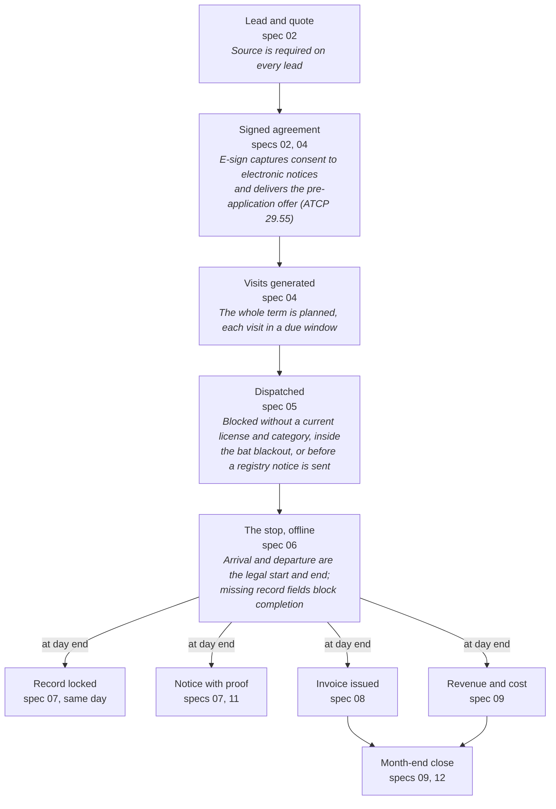
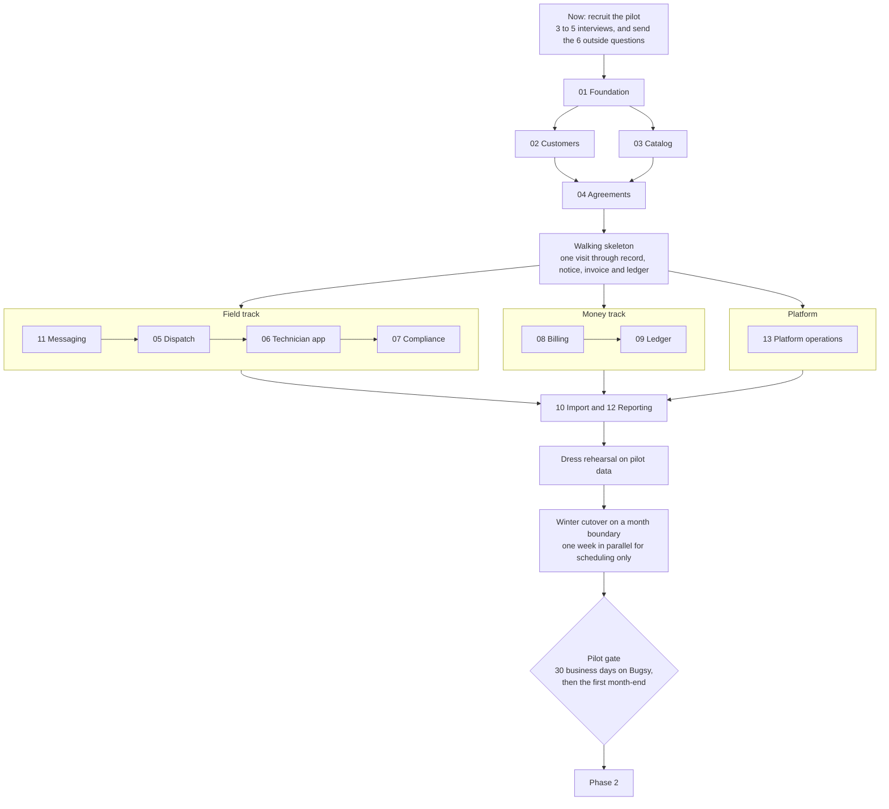

> Exported from the Claude Doc on 2026-10-29 so Claude Code sessions can read it. The doc (https://claude.ai/artifact/DKXgRTEgVsEh16AQEGekLu) is the master copy; re-export after editing it. Its three drawings appear here as a table and two Mermaid diagrams.

# Bugsy PRD (draft)

Oct 29, 2026 · @Phil

## Summary

Bugsy should win Wisconsin pest companies by making compliance and correct books a by-product of finishing a stop, while matching the table stakes every competitor already has. This draft turns the [discovery spec](https://claude.ai/artifact/PZvWbg1f2PkV4NJK7QjFqb) and the [competitor crosswalk](https://claude.ai/artifact/WDcbLu2XcpW3jwVpt5qdLN) into product decisions: who we build for first, what Phase 1 must include, how we know the pilot worked, and what the current 10-spec plan is missing.

- **Wedge:** none of the 8 competitors researched fully supports Wisconsin rules, automatic pesticide notices, restricted-use controls, a built-in general ledger or deferred revenue.
- **Table stakes:** a map dispatch board, a mobile app, field payments, autopay and standard reports are in all 8; reminder texts are in 5. Field payments, reports and reminder texts have no Phase 1 spec today.
- **First tenant:** a single-branch, residential-first Wisconsin company with 3 to 15 technicians.
- **Phase 1 gate:** 30 consecutive business days of real operations on Bugsy, with every application record locked the same day and every required notice sent on time.
- **Plan changes:** add 3 specs (customer messaging, reporting, platform operations) and make 8 changes to existing specs, led by multi-technician visits, the 10-foot rule at scheduling and opening contract balances.
- **Decisions:** 13 calls are listed at the end, each with a recommendation. 6 outside answers (DOR, DATCP, DNR, counsel) have deadlines tied to the Wisconsin season.

"Bugsy" is a working name taken from the repository.

## Problem and why now

Wisconsin pest companies run a recurring, regulated business on software built for generic field service or for other states. The cost lands on four people.

| Who | Today | What it costs them |
| --- | --- | --- |
| Owner | Software shows invoices, not contract positions; the books live in QuickBooks with an outside accountant | Revenue looks smooth while costs land in service months; a cancellation right after a visit leaks delivered but unbilled service; retention, route density and re-service cost stay invisible |
| Licensed manager | ATCP 29 records, notices, the landscape registry and license dates kept on paper, spreadsheets or generic chemical logs | A DATCP inspection means pulling paper; a missed notice or an unlicensed assignment puts the business license at risk |
| Technician | Retyping visit details; weak offline modes (Housecall Pro is view-only offline, GorillaDesk caches only the current week) | Lost time in basements and rural areas; incomplete legal records |
| Office | Billing modes, winter skips, price increases and cancellations handled by hand | Errors at the most sensitive customer moments: the bill and the cancellation |

**Why now**

- No competitor researched shows Wisconsin support. The only state reports named are California, Arizona and New York (PestPac) and California WDO (FieldRoutes).
- FieldRoutes is sunsetting ServSuite with no public end date, so its users must migrate anyway. A forced migration is a buying moment.
- Review complaints repeat across the category: bugs after updates, opaque pricing with add-on fees for SMS, GPS and card processing, dated interfaces, weak reporting, and no general ledger. PestPac users report QuickBooks reconciliation gaps.
- Horizontal tools (Jobber, Housecall Pro) are cheap and polished but have no device programs, labels, safety data sheets or state reports.

**Unknown:** the size of the Wisconsin market. Pull a count of licensed pesticide businesses with structural (7.1) applicators from DATCP before setting prices.

## Who we build for first

Recommendation: the pilot and the first 10 tenants are independent, residential-first Wisconsin pest companies with one branch and 3 to 15 technicians. Today they run on spreadsheets, a horizontal tool or ServSuite.

- Manual dispatch with simple sequencing (Phase 1) works at this size; route optimization matters more above it.
- The owner is usually also the licensed manager, so the buyer feels the compliance pain directly and decides quickly.
- There is no dedicated compliance or accounting staff, so automation replaces work nobody has time for.
- Mid-size multi-branch firms expect route optimization, commercial audit tools, commissions and deep reporting on day one. Serving them first pushes the pilot out by a phase.

Not first: owner-operators with 1 or 2 technicians (price-led buyers; GorillaDesk starts at $49 a month), multi-branch regionals, national brands and lawn-care-first companies (out of scope). The data model stays multi-branch, as spec 01 already plans.

| Persona | Role keys | Job to be done | Phase 1 must deliver |
| --- | --- | --- | --- |
| Owner and licensed manager | owner, compliance_manager | Know the business is healthy and legal | Owner dashboard, AR, renewals, credential alerts, inspector export |
| Office manager, often also the dispatcher | office, dispatcher | Sign customers, fill routes, bill, answer the phone | Customer and agreement screens, dispatch board, billing, messaging |
| Technician | technician | Finish each stop fast and never enter anything twice | Offline app, product picker, notices handled in the flow, payments |
| Outside bookkeeper | bookkeeper | Close the month | Journal, deferred revenue roll-forward, export for QuickBooks |
| Residential customer | none in Phase 1 | Know when the technician comes and pay easily | Reminders, on-the-way text, service summary, pay link |

## Positioning: table stakes and the wedge

Match the top block on day one and lead the pitch with the bottom one: 11 of the 13 wedge features have no full competitor support at all.

Competitors with full support (rated Yes; Partial and Add-on not counted), of 8 researched. Source: `docs/competitors/*.json`, researched 2026-10-20, 25 of the 80 crosswalk features.

| Group | Feature | ID | Of 8 | In Bugsy |
| --- | --- | --- | --- | --- |
| Table stakes | Dispatch board with map | SCH-02 | 8 | Spec 05 |
| Table stakes | Mobile app | MOB-01 | 8 | Spec 06 |
| Table stakes | Field payments | MOB-06 | 8 | **Not planned** |
| Table stakes | Autopay and card on file | BIL-02 | 8 | Spec 08 |
| Table stakes | Standard reports | RPT-01 | 8 | **Not planned** |
| Table stakes | Estimates and quotes | CRM-03 | 7 | Spec 02 |
| Table stakes | Multi-property accounts | CRM-09 | 7 | Spec 02 |
| Table stakes | Auto-generated recurring visits | SCH-01 | 7 | Spec 04 |
| Table stakes | Photos, notes and signature | MOB-04 | 7 | Spec 06 |
| Table stakes | Integrated payment processing | BIL-01 | 7 | Spec 08 |
| Table stakes | Reminders and on-the-way texts | CX-02 | 5 | **Not planned** |
| Table stakes | Customer portal | CX-01 | 5 | Phase 2 |
| Wedge | License-based assignment | SCH-04 | 2 | Spec 05 |
| Wedge | Seasonal programs and rounds | AGR-02 | 1 | Spec 04 |
| Wedge | Price book with tiers and add-ons | AGR-03 | 0 | Spec 03 |
| Wedge | Re-service tracking | AGR-07 | 0 | Spec 04 |
| Wedge | Catalog with EPA no., label, SDS | CMP-02 | 0 | Spec 03 |
| Wedge | Applicator license tracking | CMP-03 | 0 | Spec 07 |
| Wedge | Automatic pesticide notices | CMP-05 | 0 | Spec 07 |
| Wedge | Restricted-use controls | CMP-06 | 0 | Specs 05, 06 |
| Wedge | Wisconsin compliance | CMP-08 | 0 | Specs 05 to 07 |
| Wedge | Cancellation billing | BIL-07 | 0 | Spec 08 |
| Wedge | Built-in general ledger | ACC-01 | 0 | Spec 09 |
| Wedge | Deferred revenue | ACC-04 | 0 | Spec 09 |
| Wedge | Retention analytics | RPT-02 | 0 | **Not planned** |

**Positioning line:** for Wisconsin pest control companies, Bugsy is the system where an inspection-ready pesticide record, the customer's notice and correctly booked revenue all come from finishing the stop. Published, all-inclusive pricing (see Pricing) answers the category's most common complaint.

## Goals, non-goals and success metrics

Phase 1 succeeds when one pilot company runs its daily operations on Bugsy and its owner would pay for it.

**Goals**

1. Run a residential route end to end: sign, schedule, service, bill, book.
2. Produce a complete ATCP 29.21 record for every application on the same day, with no separate form.
3. Keep proof that every required notice went out on time.
4. Book revenue, deferred revenue and unbilled receivables per agreement exactly as the ledger fixtures define.
5. Never expose one tenant's data to another.

**Not in Phase 1:** route optimization, customer portal logins, commercial device maps and audit binders, termite graphs and warranties, multi-visit wildlife and bed bug workflows, the door-to-door app, commissions, payroll, QuickBooks API sync, bank feeds, AI features, the public website, a second state, importers for other pest software, and billing tenants for the software.

**Pilot gate** (proposed targets, to confirm with the pilot)

| Metric | Target | Measured by |
| --- | --- | --- |
| Days on Bugsy | 30 consecutive business days; no parallel system for scheduling or billing | Visits dispatched and closed in Bugsy |
| Same-day records | 100% locked by the end of the application day | application_records.locked_at against the visit date |
| Post-application notices | 100% sent within 30 days through a consented channel | notices.sent_at against due_by |
| Landscape advance notices | 100% recorded before the start at registry addresses | notices against visits.arrived_at |
| Offline capture | 0 lost visits; at least 99% sync with no manual fix | Sync log |
| Technician time per stop | Median under 3 minutes in the app, beyond the work itself | App timestamps plus before and after interviews |
| Billing | 100% of invoices issued from Bugsy | invoices |
| First month-end | Contract positions follow the fixture method; the pilot's accountant signs off | Deferred revenue roll-forward |
| Isolation | test:rls green on every merge; 0 incidents | CI |
| Value | Owner agrees to pay the proposed price after the pilot | Exit interview |

After the pilot, track tenants live, recurring revenue, logo churn, days from import to first route, and support tickets per tenant per month.

## Core journeys in Phase 1

The main journey runs from a lead to a closed month, and the technician's stop is where it pays off: one capture produces the legal record, the notice, the invoice and the journal entries.

The other journeys the pilot needs:

1. **Cancellation:** reason code and save offer; then stop autopay, cancel future visits, settle the contract balance per the terms, and bill any cancellation fee as its own line (specs 04, 08, 09).
2. **Re-service:** the customer calls, and the office books a $0 visit on the agreement; labor and product cost still post (04, 05, 09).
3. **Winter:** skipped months and interior-only visits, with flat monthly billing kept steady (04, 08).
4. **Inspection:** the compliance manager exports records, notices and licenses for a date range (07).
5. **Go-live:** import customers, properties, agreements and opening balances through a dry run, then dispatch the first routes (10).

## Phase 1 requirements by module

The specs hold the detail; this table sets what each must deliver for the pilot and proposes an answer to every question in its stub, so each `/write-spec` interview starts from a position.

| Spec | Must have for the pilot | Recommended answers to the stub questions (P1 = only if time allows) |
| --- | --- | --- |
| 01 Foundation | Tenancy, RLS, roles, branches, audit, tenant switcher, seed data | Ready as written. Pull logged, time-limited support access forward from later (see gaps) |
| 02 Customers | Accounts, properties, contacts with a resident role, leads with a required source, quotes, conversion, geocoding on save | Good, better, best quote groups: P1 (the data model already allows groups). Default lead sources: phone, referral, door to door, online directory, ads, website, other; tenants add their own. One provider for address validation, map pins and tax jurisdiction. Duplicates: warn on the same normalized address, phone or email; never auto-merge |
| 03 Catalog | Service types with tax class, certification categories, landscape flag and job kind; price book with square-foot tiers and add-ons; master product list; tenant enable and cost | Master list at launch: entered by hand from the pilot's own product list, then grown tenant by tenant. Tiers by square footage; lot size only for yard mosquito and tick. Tenant-added products: yes, with a required EPA registration number and an unverified flag until a platform admin approves |
| 04 Agreements | All cadences and seasonal rounds, initial visit, $0 re-services, three billing modes, winter skips, auto-renew, cancellation | Generate the whole term's visits as planned rows at signing; flat-monthly totals need the count. A cadence or price change regenerates only future unscheduled visits. Renewals: auto-renew per agreement plus an office renewal list 30 days ahead. Bulk yearly price increase: P1, needed before the pilot's first renewal season |
| 05 Dispatch | Technician rows by day columns with a map pane, drag and drop, order within a day, every compliance check, move a technician's whole day | Layout: rows by technician, columns by day, plus a map. Customer time windows (morning, afternoon): P1. Bulk reschedule: must have, because Wisconsin weather moves whole days |
| 06 Technician app | Offline installable web app, today's route, arrival and departure, product capture, notices and signs in the flow, photos, notes, signature, completion blocked by missing record fields, field payments | Sync conflicts: the office owns the schedule; the technician owns what was captured at the stop; an office edit to a started visit is held for review. Day-one device features: camera and GPS, no printing (see gaps). Field payments: cash, check, card on file and a texted pay link now; card readers later |
| 07 Compliance | Credentials with 60 and 30 day alerts, record lock and amendments, notice engine and log, registry import, inspector export | Registry: CSV upload with column mapping until DATCP's format is known. Export: one PDF for the inspector plus a CSV bundle. Amendments: compliance manager or owner, with a reason; the original stays visible |
| 08 Billing | Stripe Connect onboarding, invoices in all three billing modes, one statement per account, card and ACH autopay, retries, past-due flag, tax engine with every pest service type nontaxable until DOR answers | Account type: standard-style connected accounts with direct charges, so the tenant owns its Stripe relationship and losses. Platform fee: built, set to zero for the pilot. Numbering: one sequence per tenant. Late fees and commercial PO and net terms: P1 |
| 09 Ledger | Chart of accounts template, posting engine, contract balance per agreement, period-end reclass, trial balance, P&L, balance sheet, deferred revenue roll-forward, period close, summarized journal export for QuickBooks | Reopen a closed period: owner only, logged. Allocation: visit list price by default; an accountant confirms before the spec interview. Statements: trial balance, P&L and balance sheet |
| 10 Import | CSV templates for accounts, properties, contacts and agreements; dry run with row-level errors; opening AR per account | Required fields: the minimum to schedule and bill (name, service address, service type, cadence, price, billing mode, next due date). Dry run: always. History: keep pre-Bugsy records as uploaded files for the 2-year retention, not as structured records. Add opening contract balances per agreement (see gaps) |

## Gaps in the current build plan

The 10 specs cover the core, but a pilot would hit these gaps in its first week. Three need new specs; the rest change existing specs or the data model.

**New specs**

| Proposed spec | Why it is needed | Depends on | Must land before |
| --- | --- | --- | --- |
| 11 Customer messaging (email and SMS) | Reminders, on-the-way texts, the post-service summary (the ATCP 29.22 notice when consented), invoices and receipts need one sending layer: templates, opt-in, STOP handling, and delivery status as notice proof. SMS also needs carrier registration per tenant (A2P 10DLC or toll-free verification), which takes time | 01, 02 | 06 and 07 finish |
| 12 Reporting and owner dashboard | Discovery says the software must make unit economics visible; no spec does. Minimum: active agreements, recurring revenue run rate, cancellations and retention by service line and technician, stops per day, re-service rate and cost, AR aging, notices due, credentials expiring | 04, 08, 09 | The pilot gate |
| 13 Platform operations | Support access for the pilot (logged, time-limited; spec 01 defers it), a tenant onboarding checklist, platform admin for the shared product catalog, tenant data export, and what happens to records when a tenant leaves (application records must stay available 2 years) | 01 | Pilot go-live |

**Changes to existing specs and the data model**

1. **Visits need a crew, not one technician.** A trainee needs a certified applicator on site, and both the record (ATCP 29.21) and the customer notice (29.22) name everyone who applied or directly supervised. Add `visit_technicians` (visit, user, role: applicator, supervisor or helper) and keep `visits.technician_id` as the lead. Affects 04 to 07.
2. **The 10-foot rule must be known when scheduling.** The 12-hour registry notice goes out before the stop, so a treatment that reaches beyond 10 feet belongs on the agreement or service type as the planned extent. The app warns when captured work goes further than planned at a registry address. Also add `service_types.job_kind` (for example `bat_exclusion`), which the scheduling fixture uses but the data model lacks. Affects 03 to 06.
3. **Routes need an order.** Visits carry a technician and a date but no sequence. Add `visits.route_position`, or a `routes` table (technician, date, start location) if routes need their own attributes. Affects 05 and 06.
4. **Printing at the stop is unreliable.** An installed web app on iPhone cannot reach Bluetooth printers, and AirPrint needs a compatible printer in every truck. Phase 1: Bugsy generates per-tenant door hanger and ATCP Appendix D sign templates for pre-printing; the technician fills one in, posts it and photographs it as proof. Consented residents also get an electronic copy. Affects 06 and 07.
5. **Opening contract balances.** Spec 10 imports opening AR per account, but agreements already mid-term on flat monthly or annual prepay carry deferred revenue or an unbilled receivable. Import billed-to-date and delivered-to-date per agreement, or month one of the ledger is wrong. Affects 09 and 10.
6. **Chemical inventory has no owner.** The posting fixture credits `chemical_inventory` when product is used, which assumes receipts are recorded, yet no Phase 1 spec records them. Recommend minimal branch-level receipts and usage in spec 09, with truck stock and transfers in Phase 2. Changing the posting rule instead would be a deliberate fixture change.
7. **Field payments.** All 8 competitors have them and Phase 1 does not. Cash, check, card on file and a texted pay link fit a web app; card readers and tap to pay need a native wrapper, so they wait. Affects 06 and 08.
8. **License-year rollover.** Licenses end December 31. If go-live is in January, 2027 license numbers must be entered first, or the license check blocks every assignment. Add a year-end renewal task to spec 07.

## Non-functional requirements

Isolation, offline reliability and legal timestamps matter more here than speed. Numbers marked proposed are starting targets.

| Area | Requirement |
| --- | --- |
| Tenant isolation | RLS on every tenant table; `npm run test:rls` runs in CI on every merge; the service role key never reaches a browser |
| Payments security | Card data only in Stripe-hosted fields (PCI SAQ A scope); no card numbers in our database or logs |
| Audit | Audit rows on memberships, roles, settings, credentials, records, amendments and period closes; journal entries are reversed, never deleted |
| Support access | Platform staff see tenant data only through a logged, time-limited grant that the tenant can see |
| Offline | Captured visit data is durable on the device before the technician leaves the stop; sync is idempotent with client-generated ids; a full day of stops with photos works with no signal |
| Devices | The technician app runs on the pilot's actual phones: iPhone installed to the home screen and Android Chrome, current and previous OS. Confirm the models before spec 06 |
| iOS web app limits | Safari has lacked Background Sync, Web Bluetooth and the BarcodeDetector API. Plan to sync on open and on reconnect, use a JavaScript barcode decoder, and avoid any printer dependency. Spike these in week 1 of spec 06, with a native wrapper (for example Capacitor) as the fallback |
| Time | Timestamps in UTC; business dates in the tenant time zone (America/Chicago). Tests cover daylight saving changes, because record start and end times are legal data |
| Performance (proposed) | Dispatch board for 15 technicians over 2 weeks loads in under 2 seconds; the technician app opens today's route offline in under 1 second |
| Retention | Application records and notice proof kept at least 2 years (value read from the rules file), including after a tenant cancels |
| Backup | Point-in-time recovery on the production database, and a restore drill before go-live |
| Accessibility | Office app to WCAG 2.1 AA; technician app usable with gloves and in sunlight (large targets, high contrast) |
| Data ownership | A tenant can export all of its data as CSV at any time |

## Pricing and packaging

Recommendation: price per active technician per month, with unlimited office users and everything included (compliance, billing, the general ledger, SMS up to a monthly allowance), no setup fee, and published prices. The price point is a hypothesis to test with the pilot and 3 to 5 other Wisconsin companies.

| Competitor | Pricing model | Published or reported price |
| --- | --- | --- |
| GorillaDesk | Per route, unlimited office users | $49 to $149 a month including 1 route; extra routes $30 to $100 |
| Jobber | Tier plus users | $29 to $699 a month by tier, billing term and users |
| Housecall Pro | Tier with user caps | $59 to $299 a month on annual billing |
| Pocomos | Active recurring customers, unlimited users | $59 (up to 20 customers) to $225 (300 to 500) a month |
| FieldRoutes | Active customers | From about $350 a month |
| Briostack | Per user | About $95 per office user and $45 per technician a month |
| ServSuite | Per user | From $55 per user a month |
| PestPac | Per user plus setup | About $100 per user a month, setup about $1,500, annual contracts |

Source: competitor profiles in `docs/competitors/`, researched 2026-10-20.

- Technician count tracks company size and the value Bugsy creates (stops served), and owners already think in routes.
- Unlimited office users removes friction for bookkeepers and outside accountants.
- Per-customer pricing penalizes growth and swings with the season (a Pocomos complaint); per-seat pricing climbs fast (a Briostack and Jobber complaint).
- Including SMS and setup answers the most common review complaint: add-on fees.

**Starting hypothesis:** $79 to $99 per technician per month with a 2-technician minimum. An 8-technician company would pay $632 to $792 a month, above the horizontal tools and close to per-user pest software.

**Payments:** no platform fee during the pilot. Add a per-payment fee later only if the tenant's total processing cost stays at or below what it pays today, and show it on every statement.

## Pilot and rollout

Build in the kit's order, but prove the whole loop right after spec 04, run field and money work in parallel, and cut over in winter.

- **Walking skeleton:** one agreement pushed through a visit, a locked record, a notice, an invoice and a journal entry, thin but real. The kit slices by module, so integration problems would otherwise surface last.
- **Messaging first in the field track:** reminders and the post-service notice depend on it, and SMS registration has a lead time.
- **Winter, on a month boundary:** volume is lowest, so mistakes are cheaper, and opening contract balances start clean. The spring sign-up and mosquito rush then tests a system that already works. This needs 2027 licenses entered before go-live and the mosquito tax answer before spring.

## Risks

The biggest risk is scope: 13 specs before a pilot can run a day. Most of the others are unanswered outside questions with conservative defaults already planned.

| Risk | What happens | Mitigation |
| --- | --- | --- |
| Phase 1 is too big for the pilot window | The pilot slips into or past the spring rush | Walking skeleton first; hold P1 items; gate on journeys, not on spec count |
| iOS web app limits (sync, camera scanning, storage, printing) | The technician app frustrates the people it most needs to win | Spike on the pilot's phones in week 1 of spec 06; native wrapper as the fallback |
| SMS registration lead time | No texts at go-live | Start registration when the pilot signs; email as the fallback |
| Unanswered regulatory questions | Wrong blocks, wrong tax, missed notices | Rules as data in `lib/compliance/rules/wi.ts`; conservative defaults (block, do not tax, require notice); owners and deadlines under Decisions |
| An e-signed consent may not count as "prior written consent" under ATCP 29.22 | Electronic notices are invalid and paper is needed | Confirm with counsel or DATCP; Wisconsin's electronic transactions law (Wis. Stat. ch. 137) likely covers it |
| Accounting policy changes late (allocation method, inventory) | Rework in spec 09 | Accountant review before the spec 09 interview |
| Cross-tenant data leak | Loss of trust, fatal for a multi-tenant product | RLS, the isolation suite, migration hooks, the spec-reviewer agent |
| One design partner shapes the product too narrowly | A fit for one company only | 3 to 5 interview companies alongside the pilot |
| The Wisconsin market is small | Growth ceiling | Size it now; keep a second state as configuration |
| Stripe onboarding delays for a tenant | No payments at go-live | Start Connect onboarding during setup, weeks before cutover |

## Decisions needed

Thirteen calls shape Phase 1, and the first three should be made before spec 01 starts. Each has a recommendation; the last column says what waits on it.

| # | Decision | Recommendation | Blocks |
| --- | --- | --- | --- |
| 1 | First tenant profile | Single branch, residential first, 3 to 15 technicians | Pilot recruiting, spec 02 interview |
| 2 | Design partner | Recruit before the spec 02 interview, so answers come from a real company | Specs 02 to 10 |
| 3 | Stack | Confirm Next.js, Supabase and Vercel, as the kit assumes | Spec 01 |
| 4 | General ledger default | Bugsy's GL is the system of record, with a summarized journal export for QuickBooks in Phase 1 and API sync in Phase 2 | Spec 09 |
| 5 | Stripe Connect | Standard-style accounts, direct charges, platform fee built but zero | Spec 08 |
| 6 | Software pricing | Per active technician, unlimited office users, SMS included, no setup fee | Second tenant |
| 7 | Field payments | Phase 1: cash, check, card on file, texted pay link | Spec 06 |
| 8 | Customer messaging | Add spec 11 | Specs 06 and 07 |
| 9 | Reporting | Add spec 12 | Pilot gate |
| 10 | Visit crew | Add `visit_technicians` | Data model for specs 04 to 07 |
| 11 | Resident notices and signs | Pre-printed templates with photo proof; electronic copies to consented residents | Specs 06 and 07 |
| 12 | Inventory | Branch-level receipts and usage in Phase 1; truck stock in Phase 2 | Spec 09 |
| 13 | Cutover | Winter, on a month boundary, after 2027 licenses are entered | Pilot plan |

**Outside answers**

| Question | Ask | Needed by |
| --- | --- | --- |
| Is yard mosquito and tick spraying taxable? | DOR | Before the first mosquito invoice, spring 2027 |
| Which certification category covers yard tick control? | DATCP | Before tick service types are set up for the pilot |
| What format is the landscape registry distributed in? | DATCP | Before the spec 07 interview |
| What does NR 12.10 require of a hired wildlife operator, and may one work under a landowner's bat health exemption? | DNR | Before wildlife jobs are scheduled (Phase 1 blocks the blackout anyway) |
| Do state holidays count as business days for mailed landscape notices? | DATCP | Before spec 07 |
| Does an e-signed consent meet ATCP 29.22's "prior written consent"? | Counsel or DATCP | Before the e-sign flow in spec 02 or 04 |
